# Odd/Even Skyscrapers

[← All variants](README.md) · [Puzzles](../features-puzzles.md) · [How to play](../how-to-play.md)

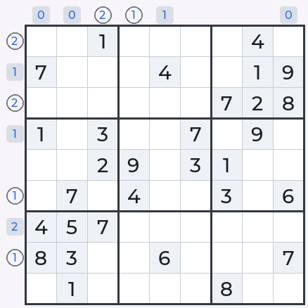

## The rules

[Classic](classic.md) rules, and clues outside the grid, as in [Skyscraper](skyscraper.md): each digit is a building that tall, and looking from a clue along its row or column, a taller building hides every shorter one behind it. But a clue counts only buildings of **one parity**:

- a **ringed** clue counts the **odd** buildings seen;
- a **shaded** clue counts the **even** ones.

In 2 5 1 9 8 the buildings seen are 2, 5 and 9: a ringed clue there is 2 (5 and 9), a shaded one 1 (the 2). The 9 is always seen, so a ringed clue is 1 at least; a shaded one can be 0.

## On the board

- The clues are in the margins left of the rows and above the columns: ringed for odd, shaded for even (like Even-Odd's cells).
- The cells from the clue up to the first empty one (or the 9) turn red when they already show more buildings of that parity than the clue, or, the 9 reached, a different count.
- The grader and hints try every order of a line's last few missing digits: "From the clue of row 6, 1 odd building is seen: of the ways its empty cells can be filled, only those leave row 6, column 1 9."
- **Puzzles → ⋮ → New puzzle → Clues → Odd/Even Sky**: about three quarters of the lines have a clue (Hard and Expert: about 60 %).

## How to solve it

- **A ringed 1:** only the 9 is the odd one seen, so every odd digit before the 9 is hidden by a taller even one, or the line starts with the 9.
- **A shaded 0:** no even building is seen, so the line starts with an odd digit taller than every even one before the 9 (often the 9 itself, or a 7 with only small evens before it).
- **Big counts need rising lines:** a ringed 5 is 1, 3, 5, 7, 9 seen in order; a shaded 4 is 2, 4, 6, 8 before the 9.

## Worked example

**variant-examples #57**, Odd/Even Skyscrapers Easy (see [Classic](classic.md#worked-example-the-whole-puzzle) for how to import the examples; cells are written r*row*c*column*). From the left, row 6's clue is a ringed **1**; from the top, column 2's is a shaded **0**.

**Step 1: r6c1, row 6 (ringed 1).** Row 6 has 7, 4, 3 and 6; column 1 has 1 and 8; box 4 has 2: that leaves 5 and 9. A 5 first would be seen, and so would the 7 after it in r6c2: two odd buildings, not 1. **r6c1 = 9** (only the 9 is seen).

**A later step: the 2 in column 2 (shaded 0).** r1c2 is the first cell of column 2: a 2 there would be an even building seen, and the clue says none. The other cells see a 2 in their row or box, or are filled. **r2c2 = 2**.

## The whole puzzle, step by step

<!-- walkthrough -->
<!-- Written by tools/walkthrough.py odd-even-skyscrapers: edit the script, not this part. -->

The whole puzzle, from the start to the last cell: 51 steps, each one a single (one place left for a digit, or one digit left for a cell), taken in the order a box's single comes first, so not quite the order of the worked example above. In each picture, the unit the step looks at is tinted yellow (for a cell with one digit left: its row, column and box), the new digit is on green, the digits that rule cells out have an **orange ring**, and the empty cells they rule out a **red cross**. Givens are on grey, digits from earlier steps in blue.

#### Step 1: the 2 in box 1

Box 1 needs a 2. r2c3: column 3 has one (r5c3). r3c1, r3c2 and r3c3: row 3 has one (r3c8). r1c1: seen from the top of column 1, 2 would already be 1 even buildings seen, more than its clue 0. r1c2: seen from the top of column 2, 2 would already be 1 even buildings seen, more than its clue 0. Only **r2c2** is left: **r2c2 = 2**.

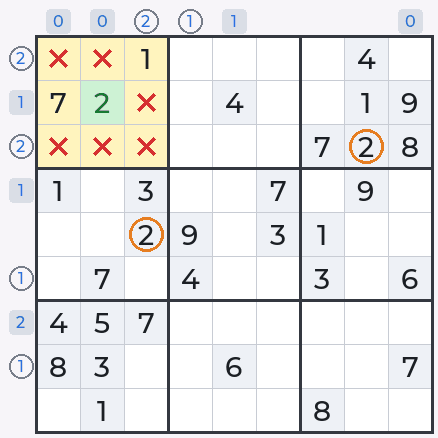

#### Step 2: the 8 in box 1

Box 1 needs an 8. r1c1: column 1 has one (r8c1). r3c1, r3c2 and r3c3: row 3 has one (r3c9). r1c2: seen from the top of column 2, 8 would already be 1 even buildings seen, more than its clue 0. Only **r2c3** is left: **r2c3 = 8**.

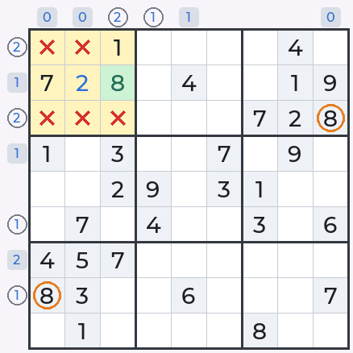

#### Step 3: the 7 in box 2

Box 2 needs a 7. r1c6: column 6 has one (r4c6). r2c4 and r2c6: row 2 has one (r2c1). r3c4, r3c5 and r3c6: row 3 has one (r3c7). r1c4: seen from the top of column 4, 7 and the 9 still to come would be more odd buildings than its clue 1. Only **r1c5** is left: **r1c5 = 7**.

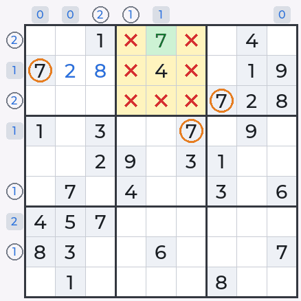

#### Step 4: the 3 in box 3

Box 3 needs a 3. r1c7 and r2c7: column 7 has one (r6c7). Only **r1c9** is left: **r1c9 = 3**.

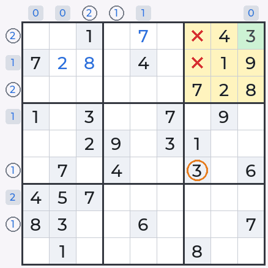

#### Step 5: the 3 in box 1

Box 1 needs a 3. r1c1 and r1c2: row 1 has one (r1c9). r3c2: column 2 has one (r8c2). r3c3: column 3 has one (r4c3). Only **r3c1** is left: **r3c1 = 3**.

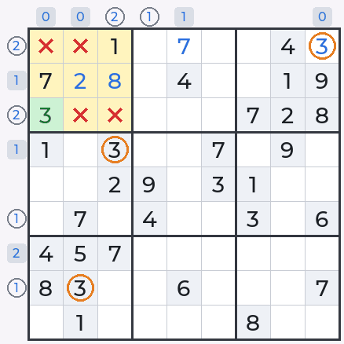

#### Step 6: the 3 in box 2

Box 2 needs a 3. r1c4 and r1c6: row 1 has one (r1c9). r2c6: column 6 has one (r5c6). r3c4, r3c5 and r3c6: row 3 has one (r3c1). Only **r2c4** is left: **r2c4 = 3**.

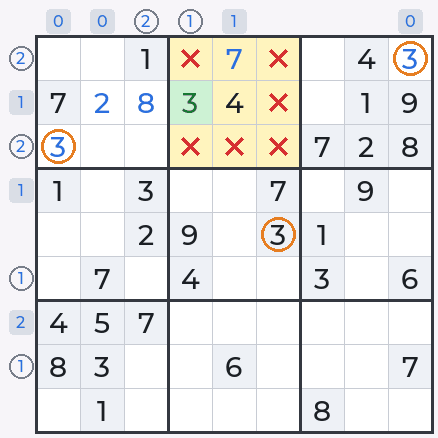

#### Step 7: the 2 in box 2

Box 2 needs a 2. r2c6: row 2 has one (r2c2). r3c4, r3c5 and r3c6: row 3 has one (r3c8). r1c4: seen from the top of column 4, 3 and the 9 still to come would be more odd buildings than its clue 1. Only **r1c6** is left: **r1c6 = 2**.

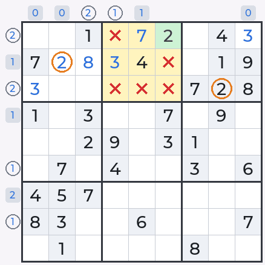

#### Step 8: the 8 in box 2

Box 2 needs an 8. r2c6: row 2 has one (r2c3). r3c4, r3c5 and r3c6: row 3 has one (r3c9). Only **r1c4** is left: **r1c4 = 8**.

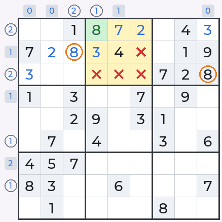

#### Step 9: the 9 in box 2

Box 2 needs a 9. r2c6: row 2 has one (r2c9). r3c4: column 4 has one (r5c4). r3c5: seen from the top of column 5, a 9 there would make 0 even buildings seen, not its clue 1. Only **r3c6** is left: **r3c6 = 9**.

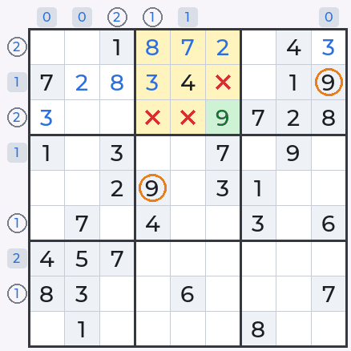

#### Step 10: the 9 in box 1

Box 1 needs a 9. r3c2 and r3c3: row 3 has one (r3c6). r1c1: seen from the left of row 1, a 9 there would make 1 odd buildings seen, not its clue 2. Only **r1c2** is left: **r1c2 = 9**.

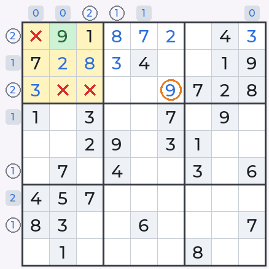

#### Step 11: the 6 in box 5

Box 5 needs a 6. r4c5 and r5c5: column 5 has one (r8c5). r6c5 and r6c6: row 6 has one (r6c9). Only **r4c4** is left: **r4c4 = 6**.

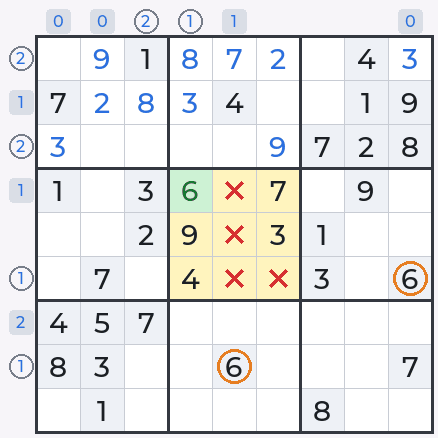

#### Step 12: the 6 in box 2

Box 2 needs a 6. r3c4: column 4 has one (r4c4). r3c5: column 5 has one (r8c5). Only **r2c6** is left: **r2c6 = 6**.

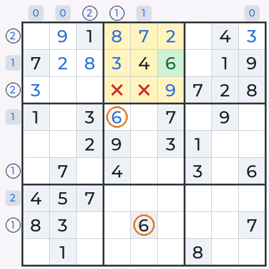

#### Step 13: the 6 in box 3

Box 3 needs a 6. r2c7: row 2 has one (r2c6). Only **r1c7** is left: **r1c7 = 6**.

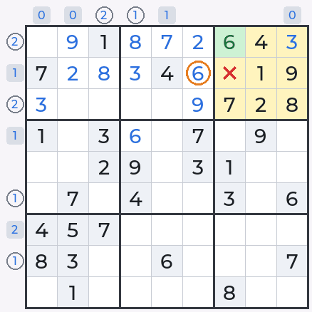

#### Step 14: the 5 in box 3

Box 3 needs a 5, and r2c7 is its last empty cell: **r2c7 = 5**.

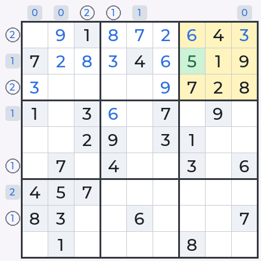

#### Step 15: the 4 in box 4

Box 4 needs a 4. r5c1: column 1 has one (r7c1). r6c1 and r6c3: row 6 has one (r6c4). r4c2: seen from the left of row 4, 4 and 6 would already be 2 even buildings seen, more than its clue 1. Only **r5c2** is left: **r5c2 = 4**.

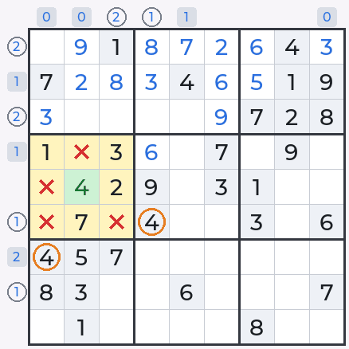

#### Step 16: the 4 in box 1

Box 1 needs a 4. r1c1: row 1 has one (r1c8). r3c2: column 2 has one (r5c2). Only **r3c3** is left: **r3c3 = 4**.

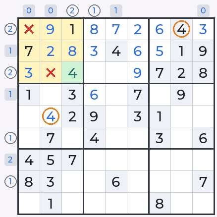

#### Step 17: the 5 in box 1

Box 1 needs a 5. r3c2: column 2 has one (r7c2). Only **r1c1** is left: **r1c1 = 5**.

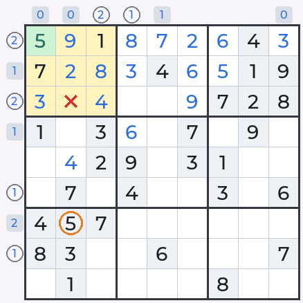

#### Step 18: the 6 in box 1

Box 1 needs a 6, and r3c2 is its last empty cell: **r3c2 = 6**.

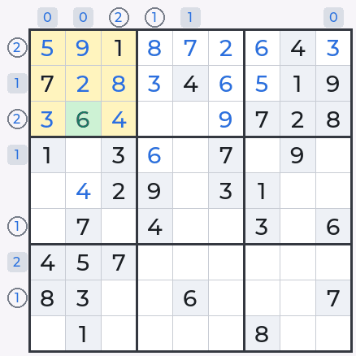

#### Step 19: the 5 in box 4

Box 4 needs a 5. r4c2: column 2 has one (r7c2). r5c1 and r6c1: column 1 has one (r1c1). Only **r6c3** is left: **r6c3 = 5**.

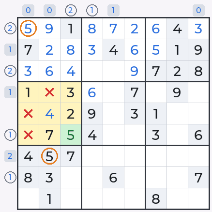

#### Step 20: the 6 in box 4

Box 4 needs a 6. r4c2: row 4 has one (r4c4). r6c1: row 6 has one (r6c9). Only **r5c1** is left: **r5c1 = 6**.

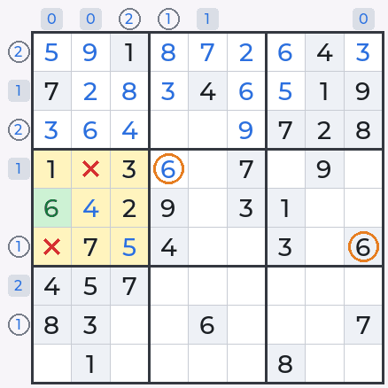

#### Step 21: the 8 in box 4

Box 4 needs an 8. r6c1: column 1 has one (r8c1). Only **r4c2** is left: **r4c2 = 8**.

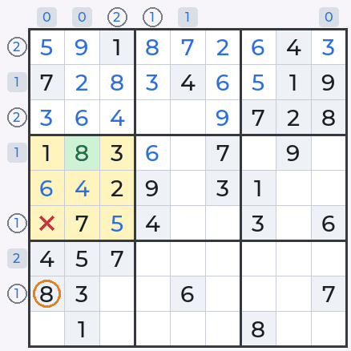

#### Step 22: the 9 in box 4

Box 4 needs a 9, and r6c1 is its last empty cell: **r6c1 = 9**.

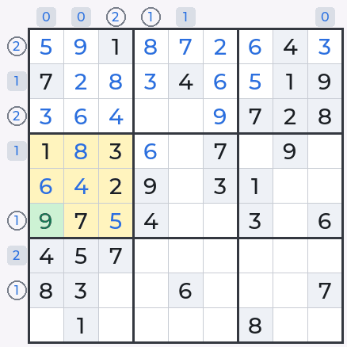

#### Step 23: the 7 in box 6

Box 6 needs a 7. r4c7 and r4c9: row 4 has one (r4c6). r5c9: column 9 has one (r8c9). r6c8: row 6 has one (r6c2). Only **r5c8** is left: **r5c8 = 7**.

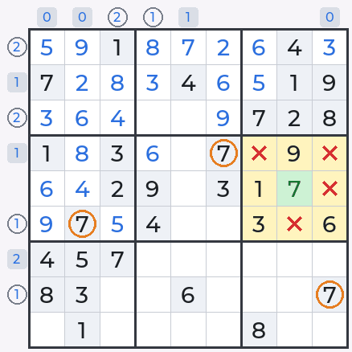

#### Step 24: the 8 in box 6

Box 6 needs an 8. r4c7 and r4c9: row 4 has one (r4c2). r5c9: column 9 has one (r3c9). Only **r6c8** is left: **r6c8 = 8**.

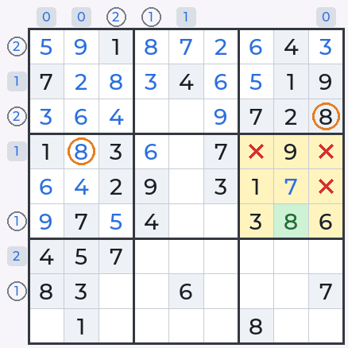

#### Step 25: the 8 in box 5

Box 5 needs an 8. r4c5: row 4 has one (r4c2). r6c5 and r6c6: row 6 has one (r6c8). Only **r5c5** is left: **r5c5 = 8**.

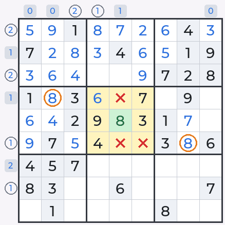

#### Step 26: the 5 in box 5

Box 5 needs a 5. r6c5 and r6c6: row 6 has one (r6c3). Only **r4c5** is left: **r4c5 = 5**.

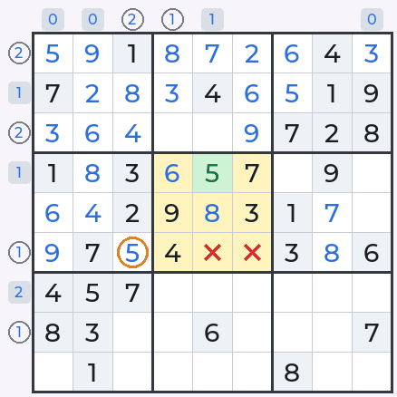

#### Step 27: the 5 in box 2

Box 2 needs a 5. r3c5: column 5 has one (r4c5). Only **r3c4** is left: **r3c4 = 5**.

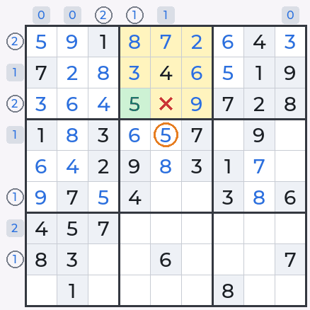

#### Step 28: the 1 in box 2

Box 2 needs a 1, and r3c5 is its last empty cell: **r3c5 = 1**.

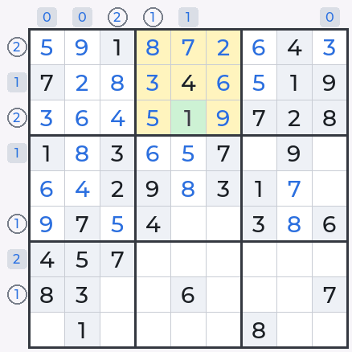

#### Step 29: the 1 in box 5

Box 5 needs a 1. r6c5: column 5 has one (r3c5). Only **r6c6** is left: **r6c6 = 1**.

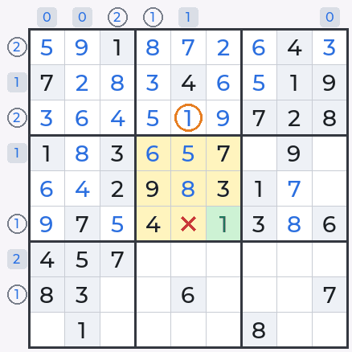

#### Step 30: the 2 in box 5

Box 5 needs a 2, and r6c5 is its last empty cell: **r6c5 = 2**.

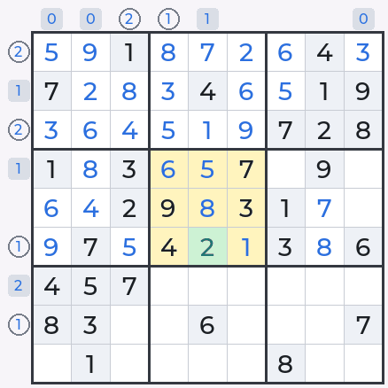

#### Step 31: the 5 in box 6

Box 6 needs a 5. r4c7 and r4c9: row 4 has one (r4c5). Only **r5c9** is left: **r5c9 = 5**.

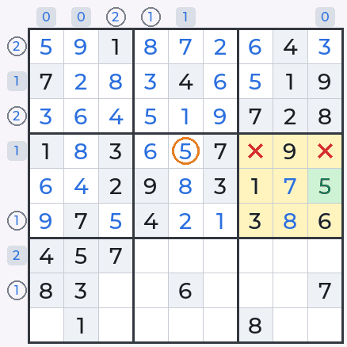

#### Step 32: the 2 in box 7

Box 7 needs a 2. r8c3 and r9c3: column 3 has one (r5c3). Only **r9c1** is left: **r9c1 = 2**.

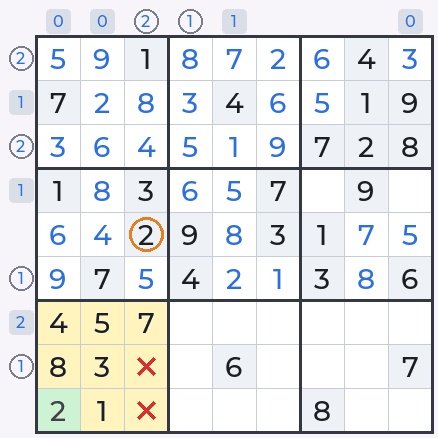

#### Step 33: the 6 in box 7

Box 7 needs a 6. r8c3: row 8 has one (r8c5). Only **r9c3** is left: **r9c3 = 6**.

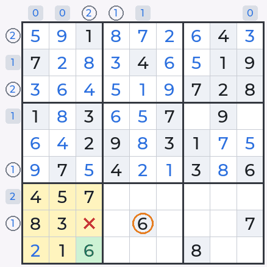

#### Step 34: the 9 in box 7

Box 7 needs a 9, and r8c3 is its last empty cell: **r8c3 = 9**.

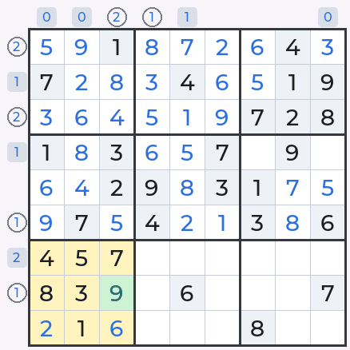

#### Step 35: the 7 in box 8

Box 8 needs a 7. r7c4, r7c5 and r7c6: row 7 has one (r7c3). r8c4 and r8c6: row 8 has one (r8c9). r9c5: column 5 has one (r1c5). r9c6: column 6 has one (r4c6). Only **r9c4** is left: **r9c4 = 7**.

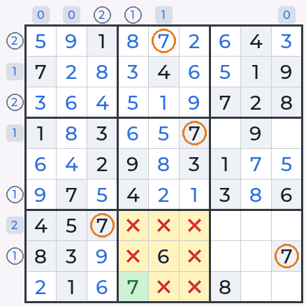

#### Step 36: the 8 in box 8

Box 8 needs an 8. r7c4: column 4 has one (r1c4). r7c5: column 5 has one (r5c5). r8c4 and r8c6: row 8 has one (r8c1). r9c5 and r9c6: row 9 has one (r9c7). Only **r7c6** is left: **r7c6 = 8**.

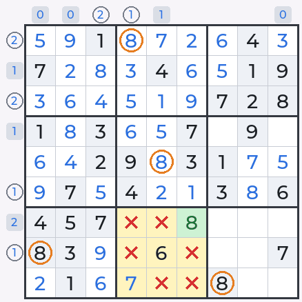

#### Step 37: the 1 in box 9

Box 9 needs a 1. r7c7 and r8c7: column 7 has one (r5c7). r7c8 and r8c8: column 8 has one (r2c8). r9c8 and r9c9: row 9 has one (r9c2). Only **r7c9** is left: **r7c9 = 1**.

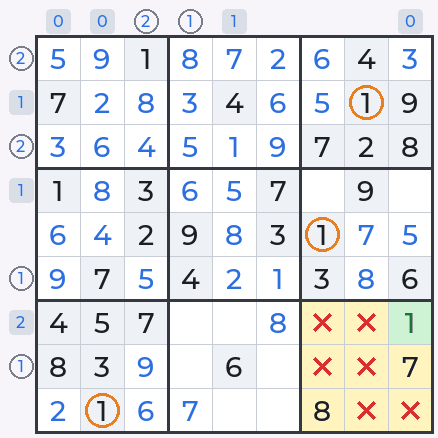

#### Step 38: the 1 in box 8

Box 8 needs a 1. r7c4 and r7c5: row 7 has one (r7c9). r8c6: column 6 has one (r6c6). r9c5 and r9c6: row 9 has one (r9c2). Only **r8c4** is left: **r8c4 = 1**.

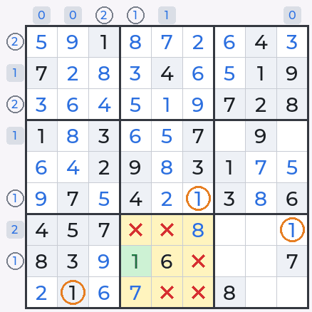

#### Step 39: the 2 in box 8

Box 8 needs a 2. r7c5: column 5 has one (r6c5). r8c6: column 6 has one (r1c6). r9c5 and r9c6: row 9 has one (r9c1). Only **r7c4** is left: **r7c4 = 2**.

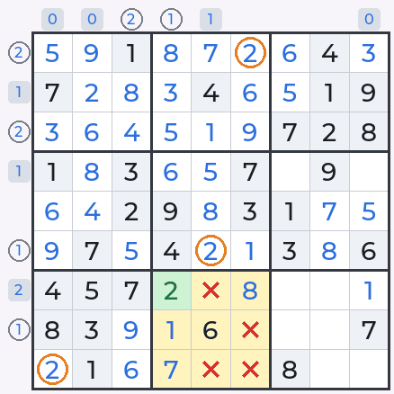

#### Step 40: the 9 in box 8

Box 8 needs a 9. r8c6: row 8 has one (r8c3). r9c6: column 6 has one (r3c6). r7c5: seen from the left of row 7, a 9 there would make 1 even buildings seen, not its clue 2. Only **r9c5** is left: **r9c5 = 9**.

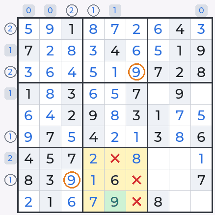

#### Step 41: the 3 in box 8

Box 8 needs a 3. r8c6: row 8 has one (r8c2). r9c6: column 6 has one (r5c6). Only **r7c5** is left: **r7c5 = 3**.

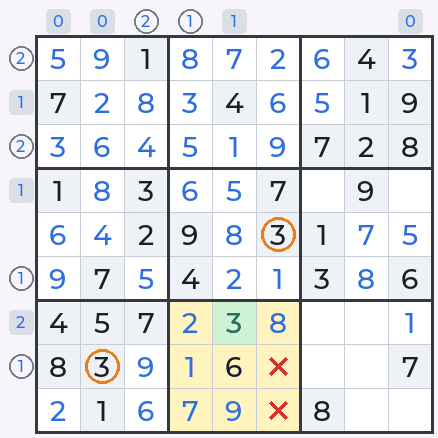

#### Step 42: the 2 in box 9

Box 9 needs a 2. r7c7 and r7c8: row 7 has one (r7c4). r8c8: column 8 has one (r3c8). r9c8 and r9c9: row 9 has one (r9c1). Only **r8c7** is left: **r8c7 = 2**.

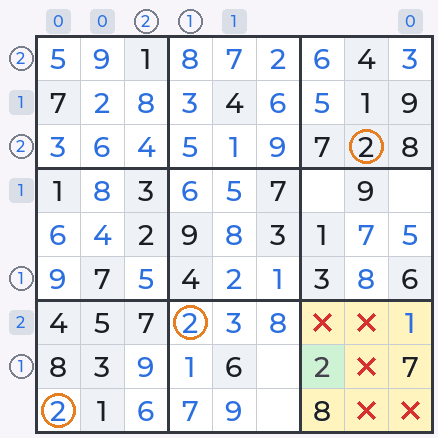

#### Step 43: the 2 in box 6

Box 6 needs a 2. r4c7: column 7 has one (r8c7). Only **r4c9** is left: **r4c9 = 2**.

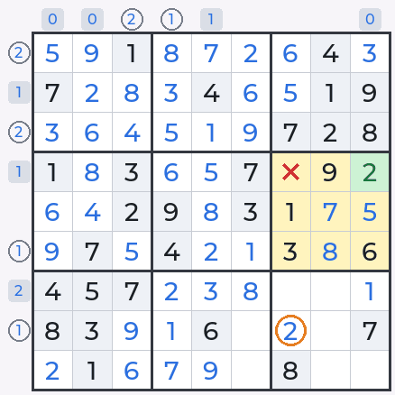

#### Step 44: the 4 in box 6

Box 6 needs a 4, and r4c7 is its last empty cell: **r4c7 = 4**.

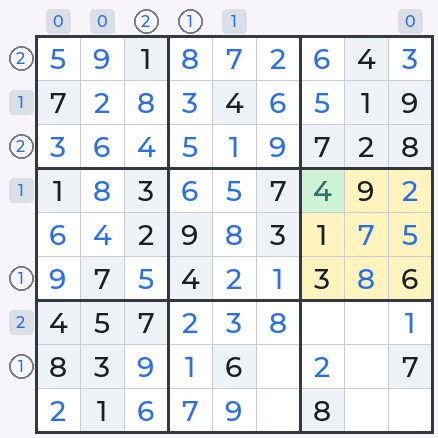

#### Step 45: the 3 in box 9

Box 9 needs a 3. r7c7 and r7c8: row 7 has one (r7c5). r8c8: row 8 has one (r8c2). r9c9: column 9 has one (r1c9). Only **r9c8** is left: **r9c8 = 3**.

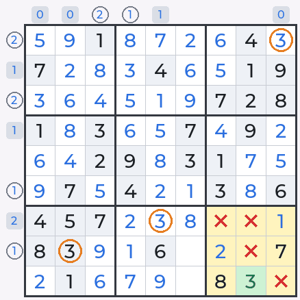

#### Step 46: the 4 in box 9

Box 9 needs a 4. r7c7 and r7c8: row 7 has one (r7c1). r8c8: column 8 has one (r1c8). Only **r9c9** is left: **r9c9 = 4**.

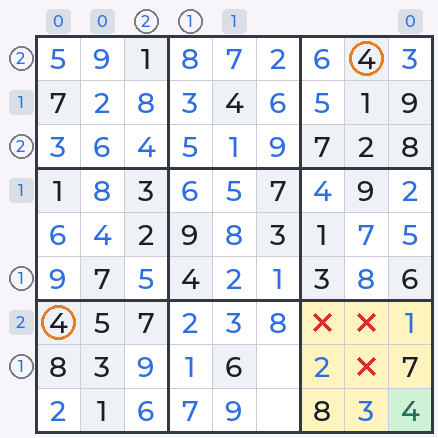

#### Step 47: the 4 in box 8

Box 8 needs a 4. r9c6: row 9 has one (r9c9). Only **r8c6** is left: **r8c6 = 4**.

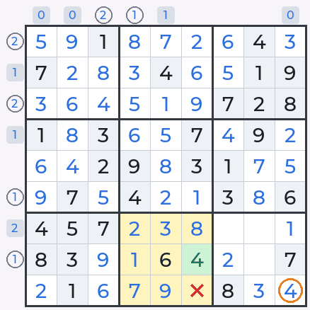

#### Step 48: the 5 in box 8

Box 8 needs a 5, and r9c6 is its last empty cell: **r9c6 = 5**.

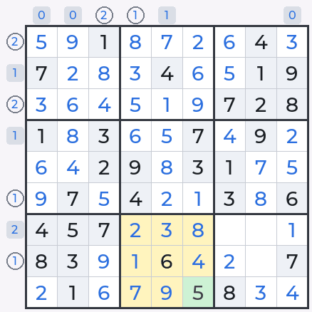

#### Step 49: the 5 in box 9

Box 9 needs a 5. r7c7 and r7c8: row 7 has one (r7c2). Only **r8c8** is left: **r8c8 = 5**.

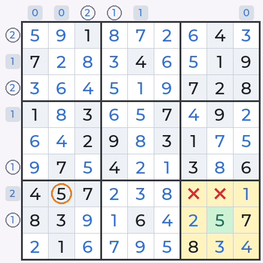

#### Step 50: the 6 in box 9

Box 9 needs a 6. r7c7: column 7 has one (r1c7). Only **r7c8** is left: **r7c8 = 6**.

#### Step 51: the 9 in box 9

Box 9 needs a 9, and r7c7 is its last empty cell: **r7c7 = 9**.

Solved.

<!-- /walkthrough -->
