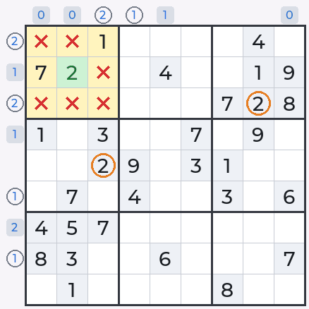

<!-- Written by tools/walkthrough.py odd-even-skyscrapers: edit the script, not this page. -->
# Odd/Even Skyscrapers, step 1: the 2 in box 1

**Step 1 of 51** · [← The start](../odd-even-skyscrapers.md#the-whole-puzzle-step-by-step) · [All steps](../odd-even-skyscrapers.md#the-whole-puzzle-step-by-step) · [Step 2 →](step-02.md)

Box 1 needs a 2. r2c3: column 3 has one (r5c3). r3c1, r3c2 and r3c3: row 3 has one (r3c8). r1c1: seen from the top of column 1, 2 would already be 1 even buildings seen, more than its clue 0. r1c2: seen from the top of column 2, 2 would already be 1 even buildings seen, more than its clue 0. Only **r2c2** is left: **r2c2 = 2**.

**Step 1 of 51** · [← The start](../odd-even-skyscrapers.md#the-whole-puzzle-step-by-step) · [All steps](../odd-even-skyscrapers.md#the-whole-puzzle-step-by-step) · [Step 2 →](step-02.md)
