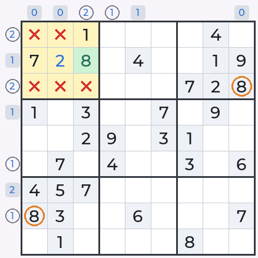

<!-- Written by tools/walkthrough.py odd-even-skyscrapers: edit the script, not this page. -->
# Odd/Even Skyscrapers, step 2: the 8 in box 1

**Step 2 of 51** · [← Step 1](step-01.md) · [All steps](../odd-even-skyscrapers.md#the-whole-puzzle-step-by-step) · [Step 3 →](step-03.md)

Box 1 needs an 8. r1c1: column 1 has one (r8c1). r3c1, r3c2 and r3c3: row 3 has one (r3c9). r1c2: seen from the top of column 2, 8 would already be 1 even buildings seen, more than its clue 0. Only **r2c3** is left: **r2c3 = 8**.

**Step 2 of 51** · [← Step 1](step-01.md) · [All steps](../odd-even-skyscrapers.md#the-whole-puzzle-step-by-step) · [Step 3 →](step-03.md)
