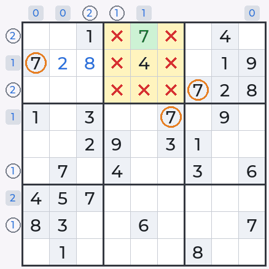

<!-- Written by tools/walkthrough.py odd-even-skyscrapers: edit the script, not this page. -->
# Odd/Even Skyscrapers, step 3: the 7 in box 2

**Step 3 of 51** · [← Step 2](step-02.md) · [All steps](../odd-even-skyscrapers.md#the-whole-puzzle-step-by-step) · [Step 4 →](step-04.md)

Box 2 needs a 7. r1c6: column 6 has one (r4c6). r2c4 and r2c6: row 2 has one (r2c1). r3c4, r3c5 and r3c6: row 3 has one (r3c7). r1c4: seen from the top of column 4, 7 and the 9 still to come would be more odd buildings than its clue 1. Only **r1c5** is left: **r1c5 = 7**.

**Step 3 of 51** · [← Step 2](step-02.md) · [All steps](../odd-even-skyscrapers.md#the-whole-puzzle-step-by-step) · [Step 4 →](step-04.md)
