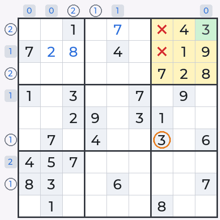

<!-- Written by tools/walkthrough.py odd-even-skyscrapers: edit the script, not this page. -->
# Odd/Even Skyscrapers, step 4: the 3 in box 3

**Step 4 of 51** · [← Step 3](step-03.md) · [All steps](../odd-even-skyscrapers.md#the-whole-puzzle-step-by-step) · [Step 5 →](step-05.md)

Box 3 needs a 3. r1c7 and r2c7: column 7 has one (r6c7). Only **r1c9** is left: **r1c9 = 3**.

**Step 4 of 51** · [← Step 3](step-03.md) · [All steps](../odd-even-skyscrapers.md#the-whole-puzzle-step-by-step) · [Step 5 →](step-05.md)
