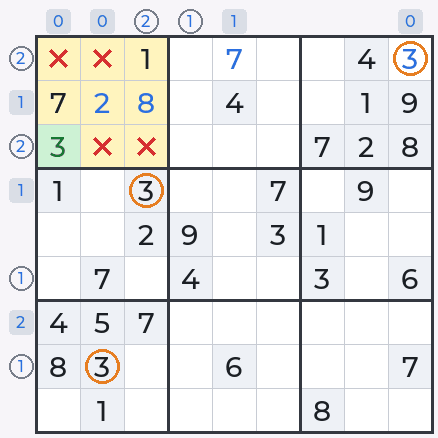

<!-- Written by tools/walkthrough.py odd-even-skyscrapers: edit the script, not this page. -->
# Odd/Even Skyscrapers, step 5: the 3 in box 1

**Step 5 of 51** · [← Step 4](step-04.md) · [All steps](../odd-even-skyscrapers.md#the-whole-puzzle-step-by-step) · [Step 6 →](step-06.md)

Box 1 needs a 3. r1c1 and r1c2: row 1 has one (r1c9). r3c2: column 2 has one (r8c2). r3c3: column 3 has one (r4c3). Only **r3c1** is left: **r3c1 = 3**.

**Step 5 of 51** · [← Step 4](step-04.md) · [All steps](../odd-even-skyscrapers.md#the-whole-puzzle-step-by-step) · [Step 6 →](step-06.md)
