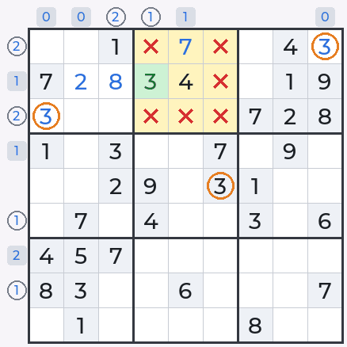

<!-- Written by tools/walkthrough.py odd-even-skyscrapers: edit the script, not this page. -->
# Odd/Even Skyscrapers, step 6: the 3 in box 2

**Step 6 of 51** · [← Step 5](step-05.md) · [All steps](../odd-even-skyscrapers.md#the-whole-puzzle-step-by-step) · [Step 7 →](step-07.md)

Box 2 needs a 3. r1c4 and r1c6: row 1 has one (r1c9). r2c6: column 6 has one (r5c6). r3c4, r3c5 and r3c6: row 3 has one (r3c1). Only **r2c4** is left: **r2c4 = 3**.

**Step 6 of 51** · [← Step 5](step-05.md) · [All steps](../odd-even-skyscrapers.md#the-whole-puzzle-step-by-step) · [Step 7 →](step-07.md)
