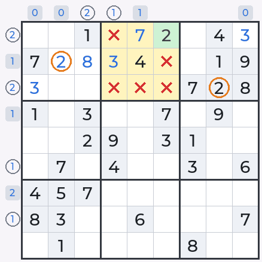

<!-- Written by tools/walkthrough.py odd-even-skyscrapers: edit the script, not this page. -->
# Odd/Even Skyscrapers, step 7: the 2 in box 2

**Step 7 of 51** · [← Step 6](step-06.md) · [All steps](../odd-even-skyscrapers.md#the-whole-puzzle-step-by-step) · [Step 8 →](step-08.md)

Box 2 needs a 2. r2c6: row 2 has one (r2c2). r3c4, r3c5 and r3c6: row 3 has one (r3c8). r1c4: seen from the top of column 4, 3 and the 9 still to come would be more odd buildings than its clue 1. Only **r1c6** is left: **r1c6 = 2**.

**Step 7 of 51** · [← Step 6](step-06.md) · [All steps](../odd-even-skyscrapers.md#the-whole-puzzle-step-by-step) · [Step 8 →](step-08.md)
