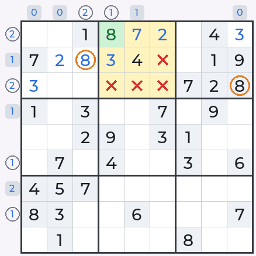

<!-- Written by tools/walkthrough.py odd-even-skyscrapers: edit the script, not this page. -->
# Odd/Even Skyscrapers, step 8: the 8 in box 2

**Step 8 of 51** · [← Step 7](step-07.md) · [All steps](../odd-even-skyscrapers.md#the-whole-puzzle-step-by-step) · [Step 9 →](step-09.md)

Box 2 needs an 8. r2c6: row 2 has one (r2c3). r3c4, r3c5 and r3c6: row 3 has one (r3c9). Only **r1c4** is left: **r1c4 = 8**.

**Step 8 of 51** · [← Step 7](step-07.md) · [All steps](../odd-even-skyscrapers.md#the-whole-puzzle-step-by-step) · [Step 9 →](step-09.md)
