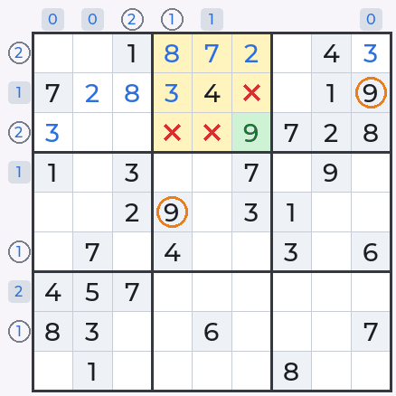

<!-- Written by tools/walkthrough.py odd-even-skyscrapers: edit the script, not this page. -->
# Odd/Even Skyscrapers, step 9: the 9 in box 2

**Step 9 of 51** · [← Step 8](step-08.md) · [All steps](../odd-even-skyscrapers.md#the-whole-puzzle-step-by-step) · [Step 10 →](step-10.md)

Box 2 needs a 9. r2c6: row 2 has one (r2c9). r3c4: column 4 has one (r5c4). r3c5: seen from the top of column 5, a 9 there would make 0 even buildings seen, not its clue 1. Only **r3c6** is left: **r3c6 = 9**.

**Step 9 of 51** · [← Step 8](step-08.md) · [All steps](../odd-even-skyscrapers.md#the-whole-puzzle-step-by-step) · [Step 10 →](step-10.md)
