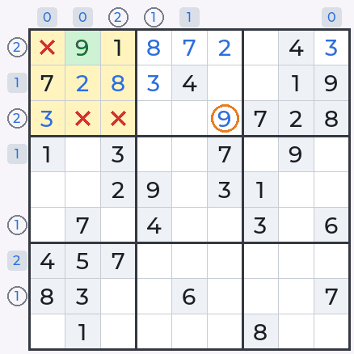

<!-- Written by tools/walkthrough.py odd-even-skyscrapers: edit the script, not this page. -->
# Odd/Even Skyscrapers, step 10: the 9 in box 1

**Step 10 of 51** · [← Step 9](step-09.md) · [All steps](../odd-even-skyscrapers.md#the-whole-puzzle-step-by-step) · [Step 11 →](step-11.md)

Box 1 needs a 9. r3c2 and r3c3: row 3 has one (r3c6). r1c1: seen from the left of row 1, a 9 there would make 1 odd buildings seen, not its clue 2. Only **r1c2** is left: **r1c2 = 9**.

**Step 10 of 51** · [← Step 9](step-09.md) · [All steps](../odd-even-skyscrapers.md#the-whole-puzzle-step-by-step) · [Step 11 →](step-11.md)
