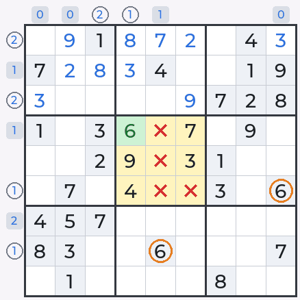

<!-- Written by tools/walkthrough.py odd-even-skyscrapers: edit the script, not this page. -->
# Odd/Even Skyscrapers, step 11: the 6 in box 5

**Step 11 of 51** · [← Step 10](step-10.md) · [All steps](../odd-even-skyscrapers.md#the-whole-puzzle-step-by-step) · [Step 12 →](step-12.md)

Box 5 needs a 6. r4c5 and r5c5: column 5 has one (r8c5). r6c5 and r6c6: row 6 has one (r6c9). Only **r4c4** is left: **r4c4 = 6**.

**Step 11 of 51** · [← Step 10](step-10.md) · [All steps](../odd-even-skyscrapers.md#the-whole-puzzle-step-by-step) · [Step 12 →](step-12.md)
