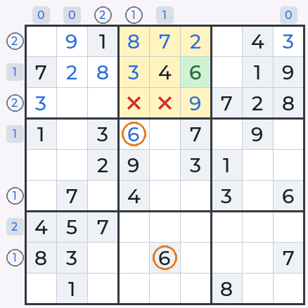

<!-- Written by tools/walkthrough.py odd-even-skyscrapers: edit the script, not this page. -->
# Odd/Even Skyscrapers, step 12: the 6 in box 2

**Step 12 of 51** · [← Step 11](step-11.md) · [All steps](../odd-even-skyscrapers.md#the-whole-puzzle-step-by-step) · [Step 13 →](step-13.md)

Box 2 needs a 6. r3c4: column 4 has one (r4c4). r3c5: column 5 has one (r8c5). Only **r2c6** is left: **r2c6 = 6**.

**Step 12 of 51** · [← Step 11](step-11.md) · [All steps](../odd-even-skyscrapers.md#the-whole-puzzle-step-by-step) · [Step 13 →](step-13.md)
