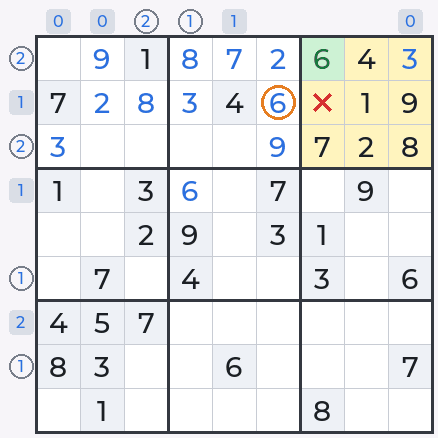

<!-- Written by tools/walkthrough.py odd-even-skyscrapers: edit the script, not this page. -->
# Odd/Even Skyscrapers, step 13: the 6 in box 3

**Step 13 of 51** · [← Step 12](step-12.md) · [All steps](../odd-even-skyscrapers.md#the-whole-puzzle-step-by-step) · [Step 14 →](step-14.md)

Box 3 needs a 6. r2c7: row 2 has one (r2c6). Only **r1c7** is left: **r1c7 = 6**.

**Step 13 of 51** · [← Step 12](step-12.md) · [All steps](../odd-even-skyscrapers.md#the-whole-puzzle-step-by-step) · [Step 14 →](step-14.md)
