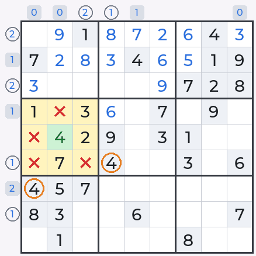

<!-- Written by tools/walkthrough.py odd-even-skyscrapers: edit the script, not this page. -->
# Odd/Even Skyscrapers, step 15: the 4 in box 4

**Step 15 of 51** · [← Step 14](step-14.md) · [All steps](../odd-even-skyscrapers.md#the-whole-puzzle-step-by-step) · [Step 16 →](step-16.md)

Box 4 needs a 4. r5c1: column 1 has one (r7c1). r6c1 and r6c3: row 6 has one (r6c4). r4c2: seen from the left of row 4, 4 and 6 would already be 2 even buildings seen, more than its clue 1. Only **r5c2** is left: **r5c2 = 4**.

**Step 15 of 51** · [← Step 14](step-14.md) · [All steps](../odd-even-skyscrapers.md#the-whole-puzzle-step-by-step) · [Step 16 →](step-16.md)
