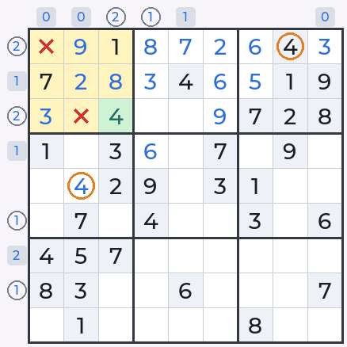

<!-- Written by tools/walkthrough.py odd-even-skyscrapers: edit the script, not this page. -->
# Odd/Even Skyscrapers, step 16: the 4 in box 1

**Step 16 of 51** · [← Step 15](step-15.md) · [All steps](../odd-even-skyscrapers.md#the-whole-puzzle-step-by-step) · [Step 17 →](step-17.md)

Box 1 needs a 4. r1c1: row 1 has one (r1c8). r3c2: column 2 has one (r5c2). Only **r3c3** is left: **r3c3 = 4**.

**Step 16 of 51** · [← Step 15](step-15.md) · [All steps](../odd-even-skyscrapers.md#the-whole-puzzle-step-by-step) · [Step 17 →](step-17.md)
