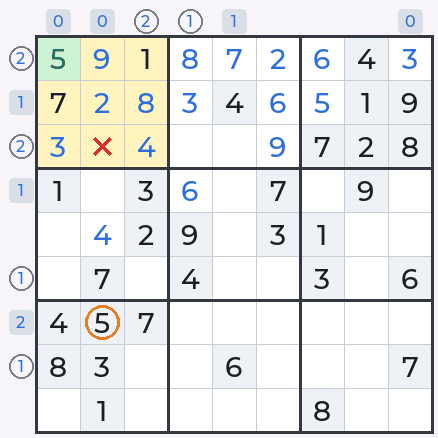

<!-- Written by tools/walkthrough.py odd-even-skyscrapers: edit the script, not this page. -->
# Odd/Even Skyscrapers, step 17: the 5 in box 1

**Step 17 of 51** · [← Step 16](step-16.md) · [All steps](../odd-even-skyscrapers.md#the-whole-puzzle-step-by-step) · [Step 18 →](step-18.md)

Box 1 needs a 5. r3c2: column 2 has one (r7c2). Only **r1c1** is left: **r1c1 = 5**.

**Step 17 of 51** · [← Step 16](step-16.md) · [All steps](../odd-even-skyscrapers.md#the-whole-puzzle-step-by-step) · [Step 18 →](step-18.md)
