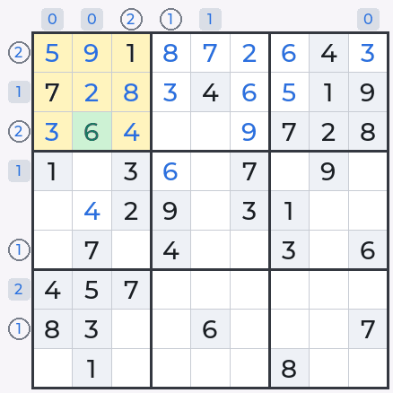

<!-- Written by tools/walkthrough.py odd-even-skyscrapers: edit the script, not this page. -->
# Odd/Even Skyscrapers, step 18: the 6 in box 1

**Step 18 of 51** · [← Step 17](step-17.md) · [All steps](../odd-even-skyscrapers.md#the-whole-puzzle-step-by-step) · [Step 19 →](step-19.md)

Box 1 needs a 6, and r3c2 is its last empty cell: **r3c2 = 6**.

**Step 18 of 51** · [← Step 17](step-17.md) · [All steps](../odd-even-skyscrapers.md#the-whole-puzzle-step-by-step) · [Step 19 →](step-19.md)
