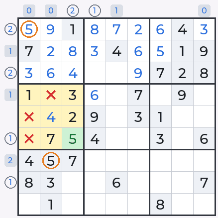

<!-- Written by tools/walkthrough.py odd-even-skyscrapers: edit the script, not this page. -->
# Odd/Even Skyscrapers, step 19: the 5 in box 4

**Step 19 of 51** · [← Step 18](step-18.md) · [All steps](../odd-even-skyscrapers.md#the-whole-puzzle-step-by-step) · [Step 20 →](step-20.md)

Box 4 needs a 5. r4c2: column 2 has one (r7c2). r5c1 and r6c1: column 1 has one (r1c1). Only **r6c3** is left: **r6c3 = 5**.

**Step 19 of 51** · [← Step 18](step-18.md) · [All steps](../odd-even-skyscrapers.md#the-whole-puzzle-step-by-step) · [Step 20 →](step-20.md)
