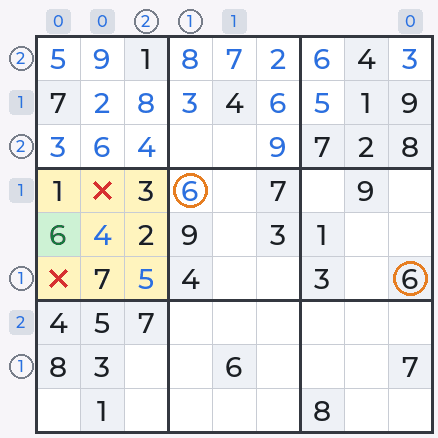

<!-- Written by tools/walkthrough.py odd-even-skyscrapers: edit the script, not this page. -->
# Odd/Even Skyscrapers, step 20: the 6 in box 4

**Step 20 of 51** · [← Step 19](step-19.md) · [All steps](../odd-even-skyscrapers.md#the-whole-puzzle-step-by-step) · [Step 21 →](step-21.md)

Box 4 needs a 6. r4c2: row 4 has one (r4c4). r6c1: row 6 has one (r6c9). Only **r5c1** is left: **r5c1 = 6**.

**Step 20 of 51** · [← Step 19](step-19.md) · [All steps](../odd-even-skyscrapers.md#the-whole-puzzle-step-by-step) · [Step 21 →](step-21.md)
