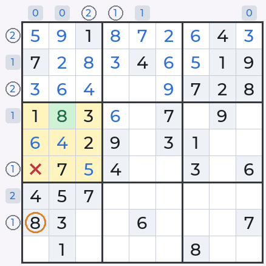

<!-- Written by tools/walkthrough.py odd-even-skyscrapers: edit the script, not this page. -->
# Odd/Even Skyscrapers, step 21: the 8 in box 4

**Step 21 of 51** · [← Step 20](step-20.md) · [All steps](../odd-even-skyscrapers.md#the-whole-puzzle-step-by-step) · [Step 22 →](step-22.md)

Box 4 needs an 8. r6c1: column 1 has one (r8c1). Only **r4c2** is left: **r4c2 = 8**.

**Step 21 of 51** · [← Step 20](step-20.md) · [All steps](../odd-even-skyscrapers.md#the-whole-puzzle-step-by-step) · [Step 22 →](step-22.md)
