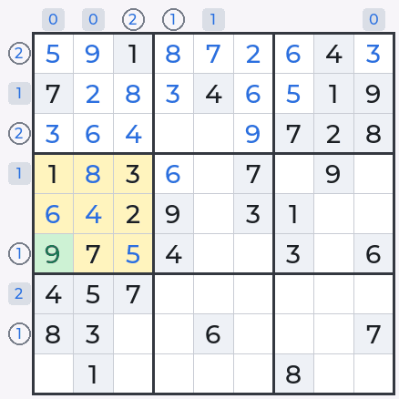

<!-- Written by tools/walkthrough.py odd-even-skyscrapers: edit the script, not this page. -->
# Odd/Even Skyscrapers, step 22: the 9 in box 4

**Step 22 of 51** · [← Step 21](step-21.md) · [All steps](../odd-even-skyscrapers.md#the-whole-puzzle-step-by-step) · [Step 23 →](step-23.md)

Box 4 needs a 9, and r6c1 is its last empty cell: **r6c1 = 9**.

**Step 22 of 51** · [← Step 21](step-21.md) · [All steps](../odd-even-skyscrapers.md#the-whole-puzzle-step-by-step) · [Step 23 →](step-23.md)
