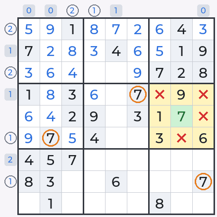

<!-- Written by tools/walkthrough.py odd-even-skyscrapers: edit the script, not this page. -->
# Odd/Even Skyscrapers, step 23: the 7 in box 6

**Step 23 of 51** · [← Step 22](step-22.md) · [All steps](../odd-even-skyscrapers.md#the-whole-puzzle-step-by-step) · [Step 24 →](step-24.md)

Box 6 needs a 7. r4c7 and r4c9: row 4 has one (r4c6). r5c9: column 9 has one (r8c9). r6c8: row 6 has one (r6c2). Only **r5c8** is left: **r5c8 = 7**.

**Step 23 of 51** · [← Step 22](step-22.md) · [All steps](../odd-even-skyscrapers.md#the-whole-puzzle-step-by-step) · [Step 24 →](step-24.md)
