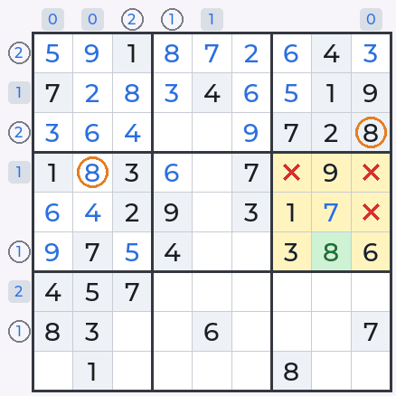

<!-- Written by tools/walkthrough.py odd-even-skyscrapers: edit the script, not this page. -->
# Odd/Even Skyscrapers, step 24: the 8 in box 6

**Step 24 of 51** · [← Step 23](step-23.md) · [All steps](../odd-even-skyscrapers.md#the-whole-puzzle-step-by-step) · [Step 25 →](step-25.md)

Box 6 needs an 8. r4c7 and r4c9: row 4 has one (r4c2). r5c9: column 9 has one (r3c9). Only **r6c8** is left: **r6c8 = 8**.

**Step 24 of 51** · [← Step 23](step-23.md) · [All steps](../odd-even-skyscrapers.md#the-whole-puzzle-step-by-step) · [Step 25 →](step-25.md)
