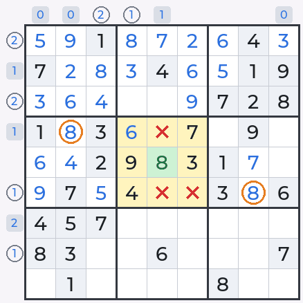

<!-- Written by tools/walkthrough.py odd-even-skyscrapers: edit the script, not this page. -->
# Odd/Even Skyscrapers, step 25: the 8 in box 5

**Step 25 of 51** · [← Step 24](step-24.md) · [All steps](../odd-even-skyscrapers.md#the-whole-puzzle-step-by-step) · [Step 26 →](step-26.md)

Box 5 needs an 8. r4c5: row 4 has one (r4c2). r6c5 and r6c6: row 6 has one (r6c8). Only **r5c5** is left: **r5c5 = 8**.

**Step 25 of 51** · [← Step 24](step-24.md) · [All steps](../odd-even-skyscrapers.md#the-whole-puzzle-step-by-step) · [Step 26 →](step-26.md)
