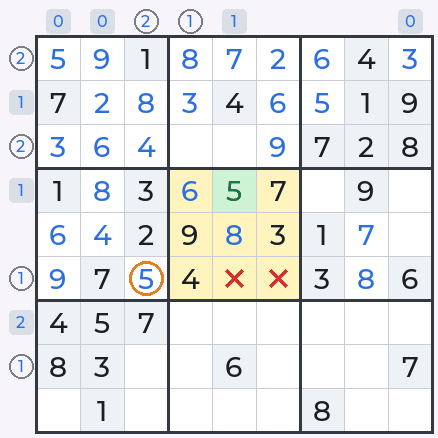

<!-- Written by tools/walkthrough.py odd-even-skyscrapers: edit the script, not this page. -->
# Odd/Even Skyscrapers, step 26: the 5 in box 5

**Step 26 of 51** · [← Step 25](step-25.md) · [All steps](../odd-even-skyscrapers.md#the-whole-puzzle-step-by-step) · [Step 27 →](step-27.md)

Box 5 needs a 5. r6c5 and r6c6: row 6 has one (r6c3). Only **r4c5** is left: **r4c5 = 5**.

**Step 26 of 51** · [← Step 25](step-25.md) · [All steps](../odd-even-skyscrapers.md#the-whole-puzzle-step-by-step) · [Step 27 →](step-27.md)
