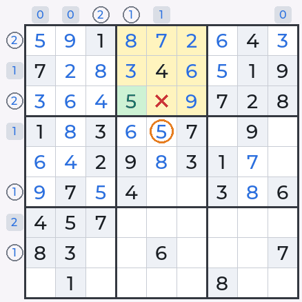

<!-- Written by tools/walkthrough.py odd-even-skyscrapers: edit the script, not this page. -->
# Odd/Even Skyscrapers, step 27: the 5 in box 2

**Step 27 of 51** · [← Step 26](step-26.md) · [All steps](../odd-even-skyscrapers.md#the-whole-puzzle-step-by-step) · [Step 28 →](step-28.md)

Box 2 needs a 5. r3c5: column 5 has one (r4c5). Only **r3c4** is left: **r3c4 = 5**.

**Step 27 of 51** · [← Step 26](step-26.md) · [All steps](../odd-even-skyscrapers.md#the-whole-puzzle-step-by-step) · [Step 28 →](step-28.md)
