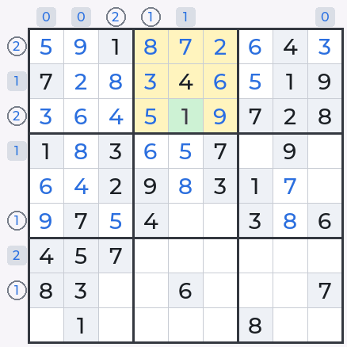

<!-- Written by tools/walkthrough.py odd-even-skyscrapers: edit the script, not this page. -->
# Odd/Even Skyscrapers, step 28: the 1 in box 2

**Step 28 of 51** · [← Step 27](step-27.md) · [All steps](../odd-even-skyscrapers.md#the-whole-puzzle-step-by-step) · [Step 29 →](step-29.md)

Box 2 needs a 1, and r3c5 is its last empty cell: **r3c5 = 1**.

**Step 28 of 51** · [← Step 27](step-27.md) · [All steps](../odd-even-skyscrapers.md#the-whole-puzzle-step-by-step) · [Step 29 →](step-29.md)
