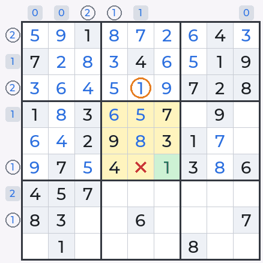

<!-- Written by tools/walkthrough.py odd-even-skyscrapers: edit the script, not this page. -->
# Odd/Even Skyscrapers, step 29: the 1 in box 5

**Step 29 of 51** · [← Step 28](step-28.md) · [All steps](../odd-even-skyscrapers.md#the-whole-puzzle-step-by-step) · [Step 30 →](step-30.md)

Box 5 needs a 1. r6c5: column 5 has one (r3c5). Only **r6c6** is left: **r6c6 = 1**.

**Step 29 of 51** · [← Step 28](step-28.md) · [All steps](../odd-even-skyscrapers.md#the-whole-puzzle-step-by-step) · [Step 30 →](step-30.md)
