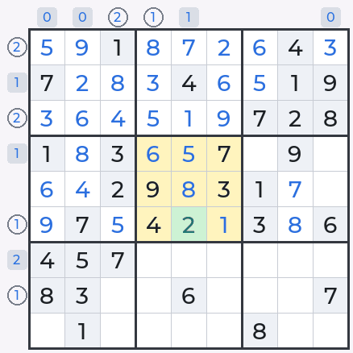

<!-- Written by tools/walkthrough.py odd-even-skyscrapers: edit the script, not this page. -->
# Odd/Even Skyscrapers, step 30: the 2 in box 5

**Step 30 of 51** · [← Step 29](step-29.md) · [All steps](../odd-even-skyscrapers.md#the-whole-puzzle-step-by-step) · [Step 31 →](step-31.md)

Box 5 needs a 2, and r6c5 is its last empty cell: **r6c5 = 2**.

**Step 30 of 51** · [← Step 29](step-29.md) · [All steps](../odd-even-skyscrapers.md#the-whole-puzzle-step-by-step) · [Step 31 →](step-31.md)
