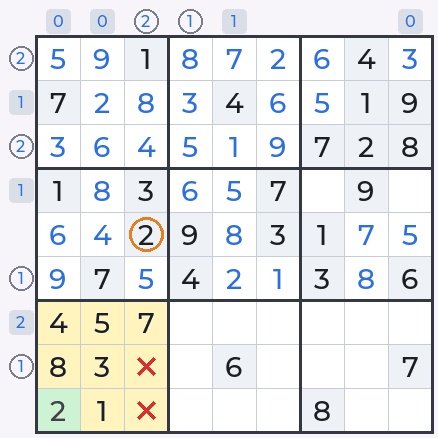

<!-- Written by tools/walkthrough.py odd-even-skyscrapers: edit the script, not this page. -->
# Odd/Even Skyscrapers, step 32: the 2 in box 7

**Step 32 of 51** · [← Step 31](step-31.md) · [All steps](../odd-even-skyscrapers.md#the-whole-puzzle-step-by-step) · [Step 33 →](step-33.md)

Box 7 needs a 2. r8c3 and r9c3: column 3 has one (r5c3). Only **r9c1** is left: **r9c1 = 2**.

**Step 32 of 51** · [← Step 31](step-31.md) · [All steps](../odd-even-skyscrapers.md#the-whole-puzzle-step-by-step) · [Step 33 →](step-33.md)
