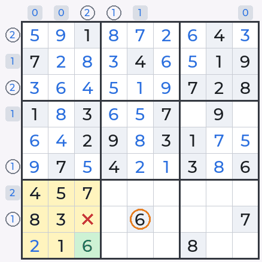

<!-- Written by tools/walkthrough.py odd-even-skyscrapers: edit the script, not this page. -->
# Odd/Even Skyscrapers, step 33: the 6 in box 7

**Step 33 of 51** · [← Step 32](step-32.md) · [All steps](../odd-even-skyscrapers.md#the-whole-puzzle-step-by-step) · [Step 34 →](step-34.md)

Box 7 needs a 6. r8c3: row 8 has one (r8c5). Only **r9c3** is left: **r9c3 = 6**.

**Step 33 of 51** · [← Step 32](step-32.md) · [All steps](../odd-even-skyscrapers.md#the-whole-puzzle-step-by-step) · [Step 34 →](step-34.md)
