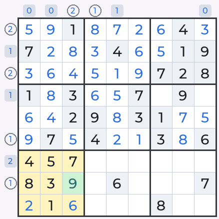

<!-- Written by tools/walkthrough.py odd-even-skyscrapers: edit the script, not this page. -->
# Odd/Even Skyscrapers, step 34: the 9 in box 7

**Step 34 of 51** · [← Step 33](step-33.md) · [All steps](../odd-even-skyscrapers.md#the-whole-puzzle-step-by-step) · [Step 35 →](step-35.md)

Box 7 needs a 9, and r8c3 is its last empty cell: **r8c3 = 9**.

**Step 34 of 51** · [← Step 33](step-33.md) · [All steps](../odd-even-skyscrapers.md#the-whole-puzzle-step-by-step) · [Step 35 →](step-35.md)
