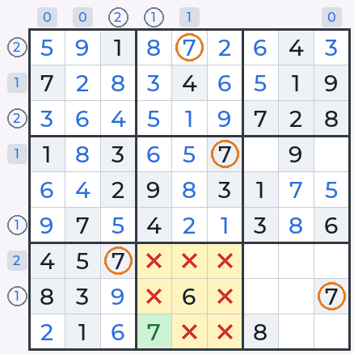

<!-- Written by tools/walkthrough.py odd-even-skyscrapers: edit the script, not this page. -->
# Odd/Even Skyscrapers, step 35: the 7 in box 8

**Step 35 of 51** · [← Step 34](step-34.md) · [All steps](../odd-even-skyscrapers.md#the-whole-puzzle-step-by-step) · [Step 36 →](step-36.md)

Box 8 needs a 7. r7c4, r7c5 and r7c6: row 7 has one (r7c3). r8c4 and r8c6: row 8 has one (r8c9). r9c5: column 5 has one (r1c5). r9c6: column 6 has one (r4c6). Only **r9c4** is left: **r9c4 = 7**.

**Step 35 of 51** · [← Step 34](step-34.md) · [All steps](../odd-even-skyscrapers.md#the-whole-puzzle-step-by-step) · [Step 36 →](step-36.md)
