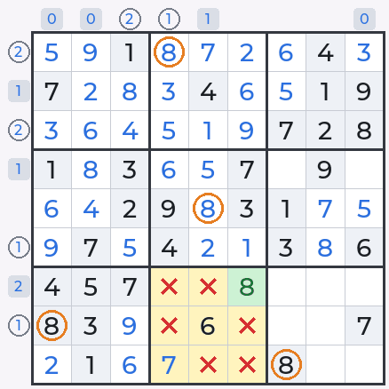

<!-- Written by tools/walkthrough.py odd-even-skyscrapers: edit the script, not this page. -->
# Odd/Even Skyscrapers, step 36: the 8 in box 8

**Step 36 of 51** · [← Step 35](step-35.md) · [All steps](../odd-even-skyscrapers.md#the-whole-puzzle-step-by-step) · [Step 37 →](step-37.md)

Box 8 needs an 8. r7c4: column 4 has one (r1c4). r7c5: column 5 has one (r5c5). r8c4 and r8c6: row 8 has one (r8c1). r9c5 and r9c6: row 9 has one (r9c7). Only **r7c6** is left: **r7c6 = 8**.

**Step 36 of 51** · [← Step 35](step-35.md) · [All steps](../odd-even-skyscrapers.md#the-whole-puzzle-step-by-step) · [Step 37 →](step-37.md)
