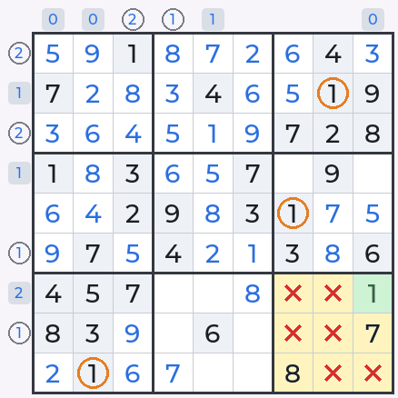

<!-- Written by tools/walkthrough.py odd-even-skyscrapers: edit the script, not this page. -->
# Odd/Even Skyscrapers, step 37: the 1 in box 9

**Step 37 of 51** · [← Step 36](step-36.md) · [All steps](../odd-even-skyscrapers.md#the-whole-puzzle-step-by-step) · [Step 38 →](step-38.md)

Box 9 needs a 1. r7c7 and r8c7: column 7 has one (r5c7). r7c8 and r8c8: column 8 has one (r2c8). r9c8 and r9c9: row 9 has one (r9c2). Only **r7c9** is left: **r7c9 = 1**.

**Step 37 of 51** · [← Step 36](step-36.md) · [All steps](../odd-even-skyscrapers.md#the-whole-puzzle-step-by-step) · [Step 38 →](step-38.md)
