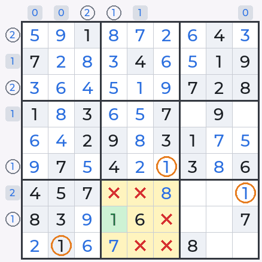

<!-- Written by tools/walkthrough.py odd-even-skyscrapers: edit the script, not this page. -->
# Odd/Even Skyscrapers, step 38: the 1 in box 8

**Step 38 of 51** · [← Step 37](step-37.md) · [All steps](../odd-even-skyscrapers.md#the-whole-puzzle-step-by-step) · [Step 39 →](step-39.md)

Box 8 needs a 1. r7c4 and r7c5: row 7 has one (r7c9). r8c6: column 6 has one (r6c6). r9c5 and r9c6: row 9 has one (r9c2). Only **r8c4** is left: **r8c4 = 1**.

**Step 38 of 51** · [← Step 37](step-37.md) · [All steps](../odd-even-skyscrapers.md#the-whole-puzzle-step-by-step) · [Step 39 →](step-39.md)
