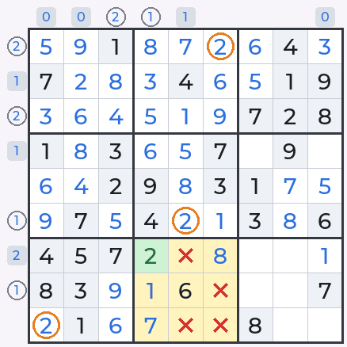

<!-- Written by tools/walkthrough.py odd-even-skyscrapers: edit the script, not this page. -->
# Odd/Even Skyscrapers, step 39: the 2 in box 8

**Step 39 of 51** · [← Step 38](step-38.md) · [All steps](../odd-even-skyscrapers.md#the-whole-puzzle-step-by-step) · [Step 40 →](step-40.md)

Box 8 needs a 2. r7c5: column 5 has one (r6c5). r8c6: column 6 has one (r1c6). r9c5 and r9c6: row 9 has one (r9c1). Only **r7c4** is left: **r7c4 = 2**.

**Step 39 of 51** · [← Step 38](step-38.md) · [All steps](../odd-even-skyscrapers.md#the-whole-puzzle-step-by-step) · [Step 40 →](step-40.md)
