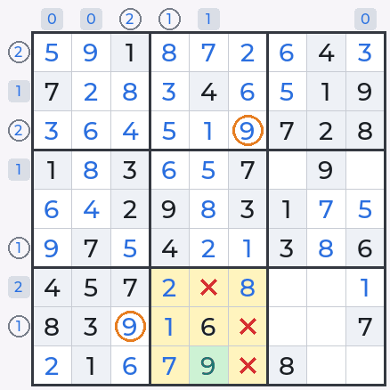

<!-- Written by tools/walkthrough.py odd-even-skyscrapers: edit the script, not this page. -->
# Odd/Even Skyscrapers, step 40: the 9 in box 8

**Step 40 of 51** · [← Step 39](step-39.md) · [All steps](../odd-even-skyscrapers.md#the-whole-puzzle-step-by-step) · [Step 41 →](step-41.md)

Box 8 needs a 9. r8c6: row 8 has one (r8c3). r9c6: column 6 has one (r3c6). r7c5: seen from the left of row 7, a 9 there would make 1 even buildings seen, not its clue 2. Only **r9c5** is left: **r9c5 = 9**.

**Step 40 of 51** · [← Step 39](step-39.md) · [All steps](../odd-even-skyscrapers.md#the-whole-puzzle-step-by-step) · [Step 41 →](step-41.md)
