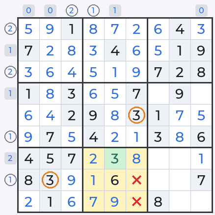

<!-- Written by tools/walkthrough.py odd-even-skyscrapers: edit the script, not this page. -->
# Odd/Even Skyscrapers, step 41: the 3 in box 8

**Step 41 of 51** · [← Step 40](step-40.md) · [All steps](../odd-even-skyscrapers.md#the-whole-puzzle-step-by-step) · [Step 42 →](step-42.md)

Box 8 needs a 3. r8c6: row 8 has one (r8c2). r9c6: column 6 has one (r5c6). Only **r7c5** is left: **r7c5 = 3**.

**Step 41 of 51** · [← Step 40](step-40.md) · [All steps](../odd-even-skyscrapers.md#the-whole-puzzle-step-by-step) · [Step 42 →](step-42.md)
