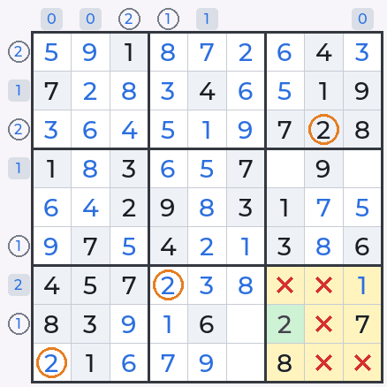

<!-- Written by tools/walkthrough.py odd-even-skyscrapers: edit the script, not this page. -->
# Odd/Even Skyscrapers, step 42: the 2 in box 9

**Step 42 of 51** · [← Step 41](step-41.md) · [All steps](../odd-even-skyscrapers.md#the-whole-puzzle-step-by-step) · [Step 43 →](step-43.md)

Box 9 needs a 2. r7c7 and r7c8: row 7 has one (r7c4). r8c8: column 8 has one (r3c8). r9c8 and r9c9: row 9 has one (r9c1). Only **r8c7** is left: **r8c7 = 2**.

**Step 42 of 51** · [← Step 41](step-41.md) · [All steps](../odd-even-skyscrapers.md#the-whole-puzzle-step-by-step) · [Step 43 →](step-43.md)
