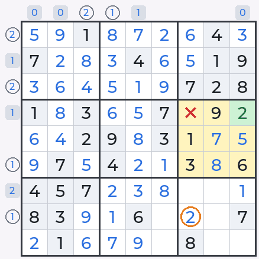

<!-- Written by tools/walkthrough.py odd-even-skyscrapers: edit the script, not this page. -->
# Odd/Even Skyscrapers, step 43: the 2 in box 6

**Step 43 of 51** · [← Step 42](step-42.md) · [All steps](../odd-even-skyscrapers.md#the-whole-puzzle-step-by-step) · [Step 44 →](step-44.md)

Box 6 needs a 2. r4c7: column 7 has one (r8c7). Only **r4c9** is left: **r4c9 = 2**.

**Step 43 of 51** · [← Step 42](step-42.md) · [All steps](../odd-even-skyscrapers.md#the-whole-puzzle-step-by-step) · [Step 44 →](step-44.md)
