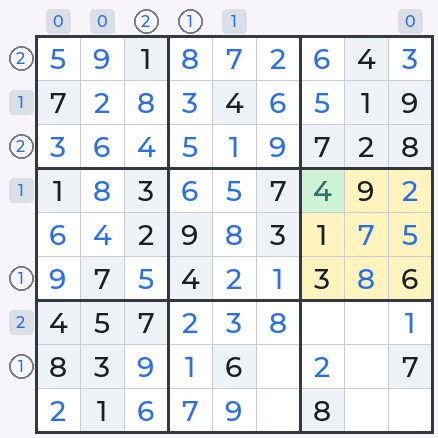

<!-- Written by tools/walkthrough.py odd-even-skyscrapers: edit the script, not this page. -->
# Odd/Even Skyscrapers, step 44: the 4 in box 6

**Step 44 of 51** · [← Step 43](step-43.md) · [All steps](../odd-even-skyscrapers.md#the-whole-puzzle-step-by-step) · [Step 45 →](step-45.md)

Box 6 needs a 4, and r4c7 is its last empty cell: **r4c7 = 4**.

**Step 44 of 51** · [← Step 43](step-43.md) · [All steps](../odd-even-skyscrapers.md#the-whole-puzzle-step-by-step) · [Step 45 →](step-45.md)
