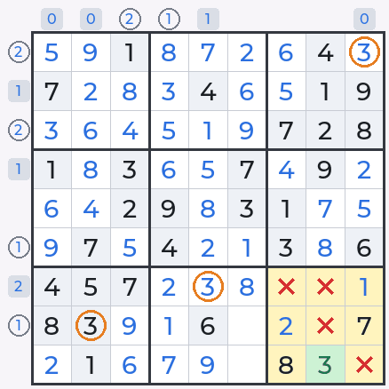

<!-- Written by tools/walkthrough.py odd-even-skyscrapers: edit the script, not this page. -->
# Odd/Even Skyscrapers, step 45: the 3 in box 9

**Step 45 of 51** · [← Step 44](step-44.md) · [All steps](../odd-even-skyscrapers.md#the-whole-puzzle-step-by-step) · [Step 46 →](step-46.md)

Box 9 needs a 3. r7c7 and r7c8: row 7 has one (r7c5). r8c8: row 8 has one (r8c2). r9c9: column 9 has one (r1c9). Only **r9c8** is left: **r9c8 = 3**.

**Step 45 of 51** · [← Step 44](step-44.md) · [All steps](../odd-even-skyscrapers.md#the-whole-puzzle-step-by-step) · [Step 46 →](step-46.md)
