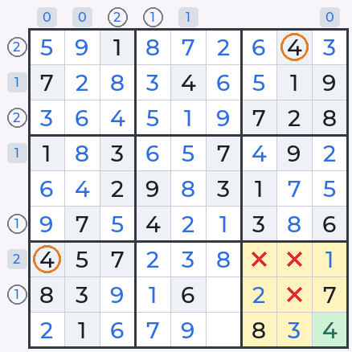

<!-- Written by tools/walkthrough.py odd-even-skyscrapers: edit the script, not this page. -->
# Odd/Even Skyscrapers, step 46: the 4 in box 9

**Step 46 of 51** · [← Step 45](step-45.md) · [All steps](../odd-even-skyscrapers.md#the-whole-puzzle-step-by-step) · [Step 47 →](step-47.md)

Box 9 needs a 4. r7c7 and r7c8: row 7 has one (r7c1). r8c8: column 8 has one (r1c8). Only **r9c9** is left: **r9c9 = 4**.

**Step 46 of 51** · [← Step 45](step-45.md) · [All steps](../odd-even-skyscrapers.md#the-whole-puzzle-step-by-step) · [Step 47 →](step-47.md)
