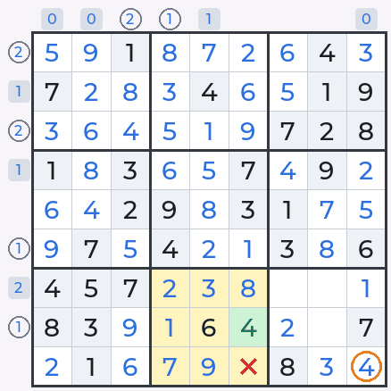

<!-- Written by tools/walkthrough.py odd-even-skyscrapers: edit the script, not this page. -->
# Odd/Even Skyscrapers, step 47: the 4 in box 8

**Step 47 of 51** · [← Step 46](step-46.md) · [All steps](../odd-even-skyscrapers.md#the-whole-puzzle-step-by-step) · [Step 48 →](step-48.md)

Box 8 needs a 4. r9c6: row 9 has one (r9c9). Only **r8c6** is left: **r8c6 = 4**.

**Step 47 of 51** · [← Step 46](step-46.md) · [All steps](../odd-even-skyscrapers.md#the-whole-puzzle-step-by-step) · [Step 48 →](step-48.md)
