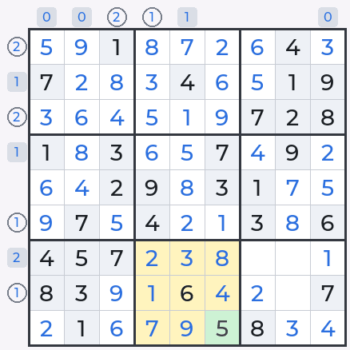

<!-- Written by tools/walkthrough.py odd-even-skyscrapers: edit the script, not this page. -->
# Odd/Even Skyscrapers, step 48: the 5 in box 8

**Step 48 of 51** · [← Step 47](step-47.md) · [All steps](../odd-even-skyscrapers.md#the-whole-puzzle-step-by-step) · [Step 49 →](step-49.md)

Box 8 needs a 5, and r9c6 is its last empty cell: **r9c6 = 5**.

**Step 48 of 51** · [← Step 47](step-47.md) · [All steps](../odd-even-skyscrapers.md#the-whole-puzzle-step-by-step) · [Step 49 →](step-49.md)
