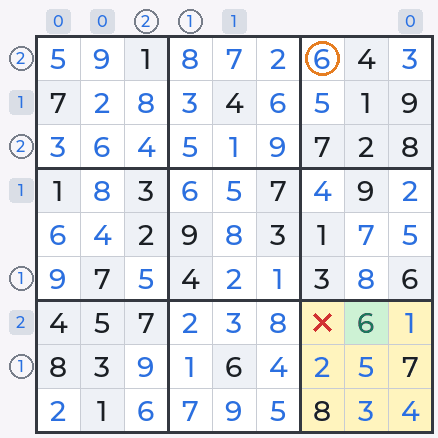

<!-- Written by tools/walkthrough.py odd-even-skyscrapers: edit the script, not this page. -->
# Odd/Even Skyscrapers, step 50: the 6 in box 9

**Step 50 of 51** · [← Step 49](step-49.md) · [All steps](../odd-even-skyscrapers.md#the-whole-puzzle-step-by-step) · [Step 51 →](step-51.md)

Box 9 needs a 6. r7c7: column 7 has one (r1c7). Only **r7c8** is left: **r7c8 = 6**.

**Step 50 of 51** · [← Step 49](step-49.md) · [All steps](../odd-even-skyscrapers.md#the-whole-puzzle-step-by-step) · [Step 51 →](step-51.md)
