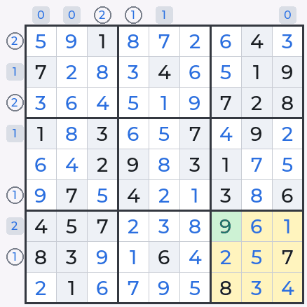

<!-- Written by tools/walkthrough.py odd-even-skyscrapers: edit the script, not this page. -->
# Odd/Even Skyscrapers, step 51: the 9 in box 9

**Step 51 of 51** · [← Step 50](step-50.md) · [All steps](../odd-even-skyscrapers.md#the-whole-puzzle-step-by-step) · [All steps](../odd-even-skyscrapers.md#the-whole-puzzle-step-by-step)

Box 9 needs a 9, and r7c7 is its last empty cell: **r7c7 = 9**.

Solved.

**Step 51 of 51** · [← Step 50](step-50.md) · [All steps](../odd-even-skyscrapers.md#the-whole-puzzle-step-by-step) · [All steps](../odd-even-skyscrapers.md#the-whole-puzzle-step-by-step)
