# Outside Sudoku

[← All variants](README.md) · [Puzzles](../features-puzzles.md) · [How to play](../how-to-play.md)

## The rules

[Classic](classic.md) rules, and **clues** left of some rows and above some columns. A clue lists **1 to 3 digits that are among the first three cells** from there (the cells of that row or column in the first box), in any order. With 5, 8, 2 as the first three, a clue of **25** fits; the third cell can be anything else. A line without a clue has no such rule.

Since a row holds each digit once, a clue's digits are **nowhere else in that row** (or column).

## On the board

- The clues are in blue in a margin left of the rows and above the columns, their digits side by side; a line without a clue has none.
- The first three cells of a line turn red when fewer of them are empty than the clue's digits still missing.
- The grader and hints keep a clue's digits out of the rest of its row or column from the start, and narrow the first three cells to what leaves room for the clue: "The clue of column 4 says 1, 5, 8 are among its first three cells, so row 2, column 4 can only be 8".
- **Puzzles → ⋮ → New puzzle → Clues → Outside**: about 85 % of the lines have a clue (Hard and Expert: about 70 %), each with 1 to 3 of its first three digits.

## How to solve it

- **The rest of the line is out:** a clue's digits can't be anywhere past the first three cells of its row or column.
- **A three-digit clue fills the cells:** the three cells hold exactly those digits, in some order, like a little box.
- **Two clues meet in a corner box:** the first three cells of row 1 and of column 1 share the top-left cell; a digit in both clues is a strong hint it sits there.
- **Count the room:** with one empty cell left among the three and a clue digit still missing, that digit goes in it.

## Worked example

**variant-examples #35**, Outside Sudoku Easy (see [Classic](classic.md#worked-example-the-whole-puzzle) for how to import the examples; cells are written r*row*c*column*). The clues are in the screenshot; from the left, row 3's is **7**; from the top, column 1's is **37** and column 4's **158**.

**Step 1: r2c4, column 4 (clue 158).** Row 2 has 1 and 4; column 4 has 3, 5 and 6; box 2 has 7 and 9: that leaves 2 and 8. Column 4's first three cells must hold 1, 5 and 8. r1c4 is the 5, so 1 and 8 go in r2c4 and r3c4, and row 2 already has its 1. **r2c4 = 8**.

**Step 2: r3c8, row 3 (clue 7).** Row 3 has 3, 4, 5, 8 and 9; column 8 has 1 and 6: that leaves 2 and 7. Row 3's clue puts its 7 among its first three cells, so it can't be in r3c8. **r3c8 = 2**.

**Step 3: r6c1, column 1 (clue 37).** Row 6 has 1, 3, 4 and 6; column 1 has 5, 8 and 9: that leaves 2 and 7. Column 1's clue puts its 7 among its first three cells (rows 1 to 3), so not in row 6. **r6c1 = 2**.

## The whole puzzle, step by step

<!-- walkthrough -->
<!-- Written by tools/walkthrough.py outside-sudoku: edit the script, not this part. -->

The whole puzzle, from the start to the last cell: 49 steps, each one a single (one place left for a digit, or one digit left for a cell), taken in the order a box's single comes first, so not quite the order of the worked example above. In each picture, the unit the step looks at is tinted yellow (for a cell with one digit left: its row, column and box), the new digit is on green, the digits that rule cells out have an **orange ring**, and the empty cells they rule out a **red cross**. Givens are on grey, digits from earlier steps in blue.

#### Step 1: the 5 in box 1

Box 1 needs a 5. r1c1, r1c2 and r1c3: row 1 has one (r1c4). r2c1: column 1 has one (r4c1). r2c2: column 2 has one (r9c2). r3c1 and r3c2: row 3 has one (r3c7). Only **r2c3** is left: **r2c3 = 5**.

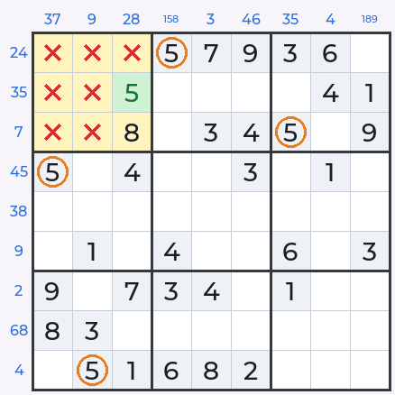

#### Step 2: the 3 in box 1

Box 1 needs a 3. r1c1, r1c2 and r1c3: row 1 has one (r1c7). r2c2: column 2 has one (r8c2). r3c1 and r3c2: row 3 has one (r3c5). Only **r2c1** is left: **r2c1 = 3**.

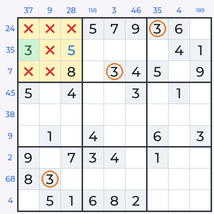

#### Step 3: the 9 in box 1

Box 1 needs a 9. r1c1, r1c2 and r1c3: row 1 has one (r1c6). r3c1 and r3c2: row 3 has one (r3c9). Only **r2c2** is left: **r2c2 = 9**.

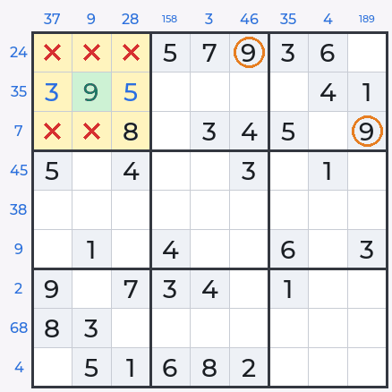

#### Step 4: the 1 in box 2

Box 2 needs a 1. r2c4, r2c5 and r2c6: row 2 has one (r2c9). Only **r3c4** is left: **r3c4 = 1**.

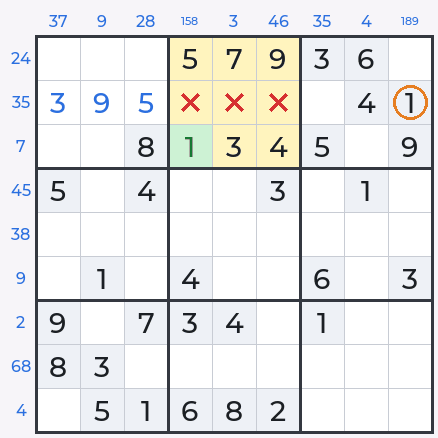

#### Step 5: the 1 in box 1

Box 1 needs a 1. r1c2: column 2 has one (r6c2). r1c3: column 3 has one (r9c3). r3c1 and r3c2: row 3 has one (r3c4). Only **r1c1** is left: **r1c1 = 1**.

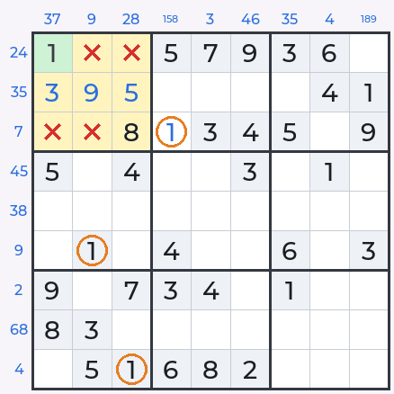

#### Step 6: the 4 in box 1

Box 1 needs a 4. r1c3: column 3 has one (r4c3). r3c1 and r3c2: row 3 has one (r3c6). Only **r1c2** is left: **r1c2 = 4**.

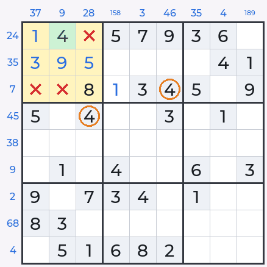

#### Step 7: the 6 in box 1

Box 1 needs a 6. r1c3: row 1 has one (r1c8). r3c1: Column 1's clue puts 3 and 7 among its first three cells: with a 6 here, there'd be no room left for 7. Only **r3c2** is left: **r3c2 = 6**.

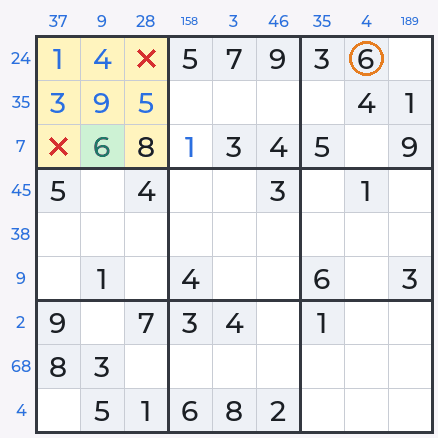

#### Step 8: the 2 in box 1

Box 1 needs a 2. r3c1: Row 3's clue puts 7 among its first three cells: with a 2 here, there'd be no room left for 7. Only **r1c3** is left: **r1c3 = 2**.

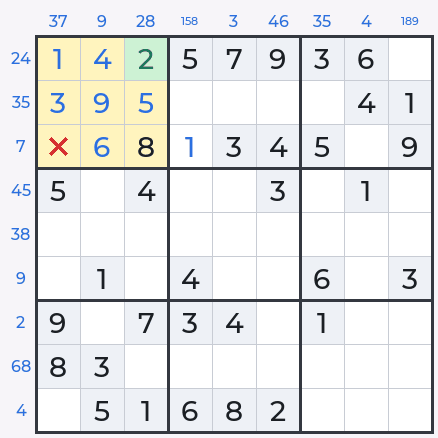

#### Step 9: the 7 in box 1

Box 1 needs a 7, and r3c1 is its last empty cell: **r3c1 = 7**.

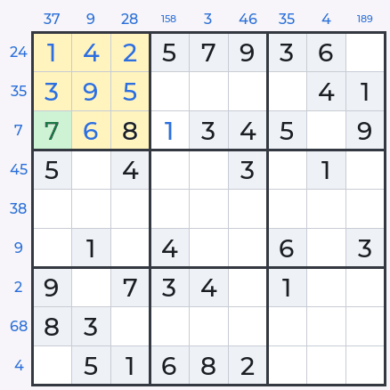

#### Step 10: the 2 in box 2

Box 2 needs a 2. r2c6: column 6 has one (r9c6). r2c4: Column 4's clue puts 1, 5 and 8 among its first three cells: with a 2 here, there'd be no room left for 8. Only **r2c5** is left: **r2c5 = 2**.

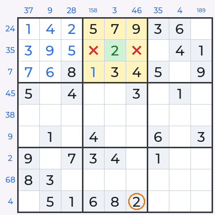

#### Step 11: the 6 in box 2

Box 2 needs a 6. r2c4: column 4 has one (r9c4). Only **r2c6** is left: **r2c6 = 6**.

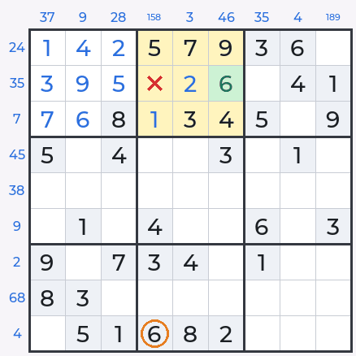

#### Step 12: the 8 in box 2

Box 2 needs an 8, and r2c4 is its last empty cell: **r2c4 = 8**.

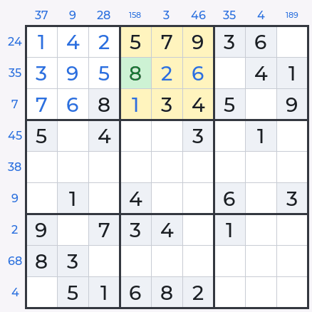

#### Step 13: the 2 in box 3

Box 3 needs a 2. r1c9: row 1 has one (r1c3). r2c7: row 2 has one (r2c5). Only **r3c8** is left: **r3c8 = 2**.

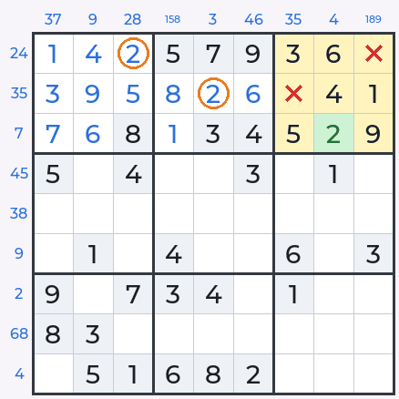

#### Step 14: the 7 in box 3

Box 3 needs a 7. r1c9: row 1 has one (r1c5). Only **r2c7** is left: **r2c7 = 7**.

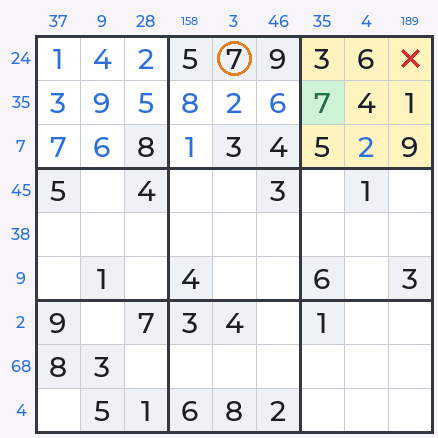

#### Step 15: the 8 in box 3

Box 3 needs an 8, and r1c9 is its last empty cell: **r1c9 = 8**.

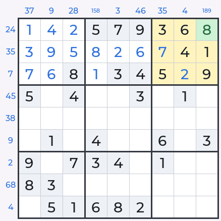

#### Step 16: the 3 in box 4

Box 4 needs a 3. r4c2: row 4 has one (r4c6). r5c1: column 1 has one (r2c1). r5c2: column 2 has one (r8c2). r6c1 and r6c3: row 6 has one (r6c9). Only **r5c3** is left: **r5c3 = 3**.

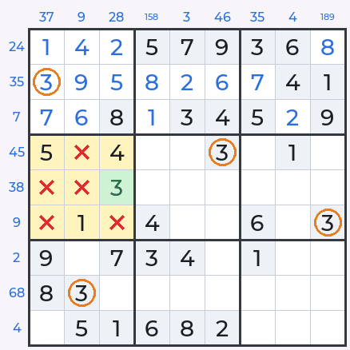

#### Step 17: the 6 in box 4

Box 4 needs a 6. r4c2 and r5c2: column 2 has one (r3c2). r6c1 and r6c3: row 6 has one (r6c7). Only **r5c1** is left: **r5c1 = 6**.

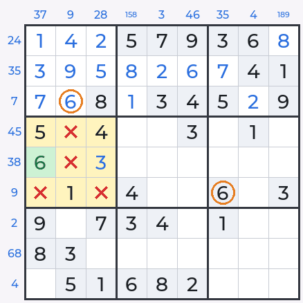

#### Step 18: the 7 in box 4

Box 4 needs a 7. r6c1: column 1 has one (r3c1). r6c3: column 3 has one (r7c3). r5c2: Row 5's clue puts 3 and 8 among its first three cells: with a 7 here, there'd be no room left for 8. Only **r4c2** is left: **r4c2 = 7**.

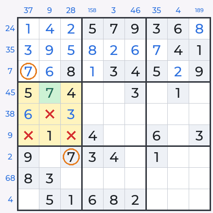

#### Step 19: the 2 in box 4

Box 4 needs a 2. r6c3: column 3 has one (r1c3). r5c2: Row 5's clue puts 3 and 8 among its first three cells: with a 2 here, there'd be no room left for 8. Only **r6c1** is left: **r6c1 = 2**.

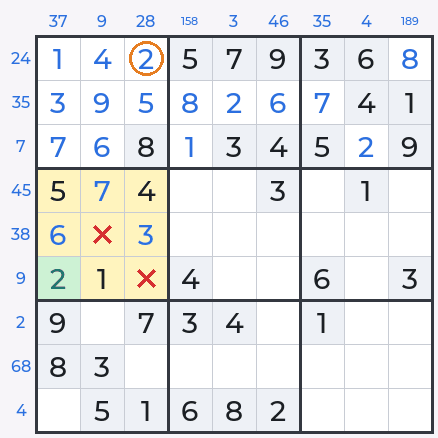

#### Step 20: the 8 in box 4

Box 4 needs an 8. r6c3: column 3 has one (r3c3). Only **r5c2** is left: **r5c2 = 8**.

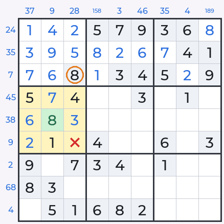

#### Step 21: the 9 in box 4

Box 4 needs a 9, and r6c3 is its last empty cell: **r6c3 = 9**.

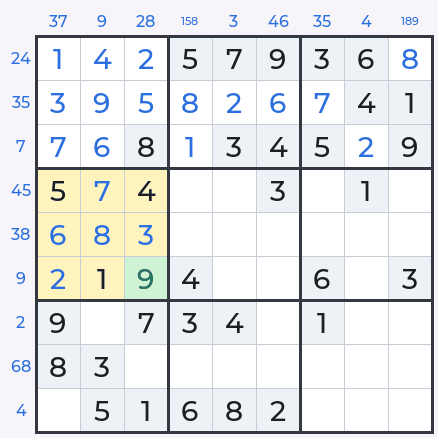

#### Step 22: the 6 in box 5

Box 5 needs a 6. r4c4: column 4 has one (r9c4). r5c4, r5c5 and r5c6: row 5 has one (r5c1). r6c5 and r6c6: row 6 has one (r6c7). Only **r4c5** is left: **r4c5 = 6**.

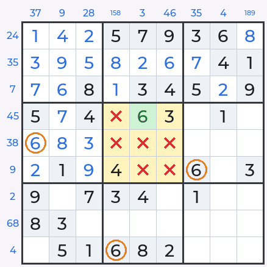

#### Step 23: the 8 in box 5

Box 5 needs an 8. r4c4: column 4 has one (r2c4). r5c4, r5c5 and r5c6: row 5 has one (r5c2). r6c5: column 5 has one (r9c5). Only **r6c6** is left: **r6c6 = 8**.

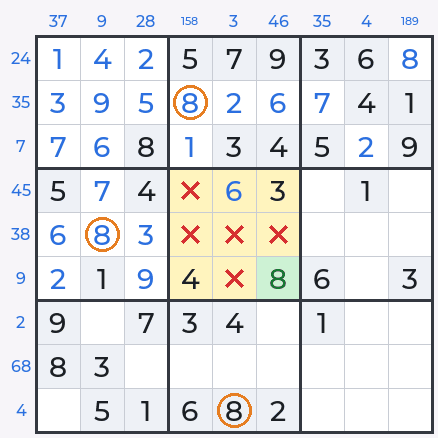

#### Step 24: the 8 in box 6

Box 6 needs an 8. r4c9: column 9 has one (r1c9). r5c7, r5c8 and r5c9: row 5 has one (r5c2). r6c8: row 6 has one (r6c6). Only **r4c7** is left: **r4c7 = 8**.

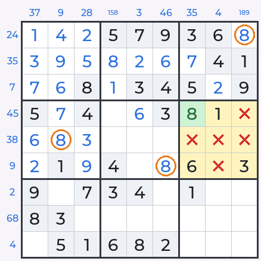

#### Step 25: the 2 in box 7

Box 7 needs a 2. r8c3: column 3 has one (r1c3). r9c1: row 9 has one (r9c6). Only **r7c2** is left: **r7c2 = 2**.

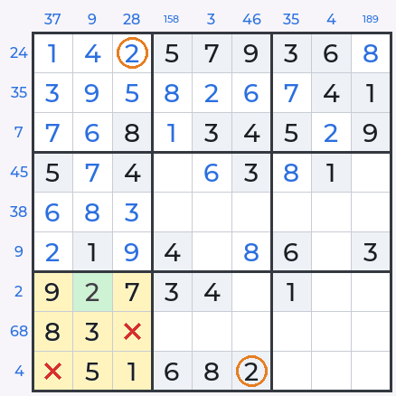

#### Step 26: the 4 in box 7

Box 7 needs a 4. r8c3: column 3 has one (r4c3). Only **r9c1** is left: **r9c1 = 4**.

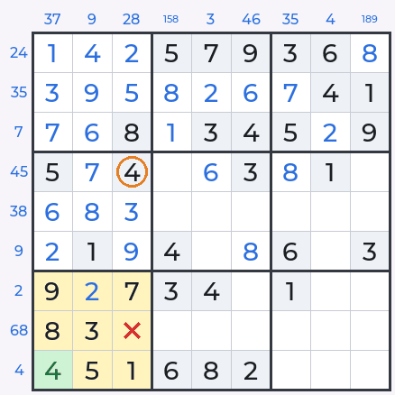

#### Step 27: the 6 in box 7

Box 7 needs a 6, and r8c3 is its last empty cell: **r8c3 = 6**.

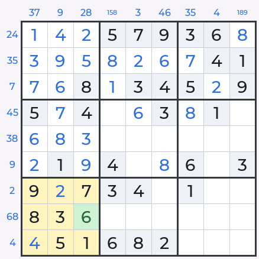

#### Step 28: the 3 in box 9

Box 9 needs a 3. r7c8 and r7c9: row 7 has one (r7c4). r8c7, r8c8 and r8c9: row 8 has one (r8c2). r9c7: column 7 has one (r1c7). r9c9: column 9 has one (r6c9). Only **r9c8** is left: **r9c8 = 3**.

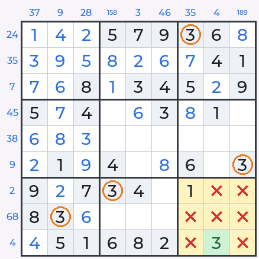

#### Step 29: the 6 in box 9

Box 9 needs a 6. r7c8: column 8 has one (r1c8). r8c7, r8c8 and r8c9: row 8 has one (r8c3). r9c7 and r9c9: row 9 has one (r9c4). Only **r7c9** is left: **r7c9 = 6**.

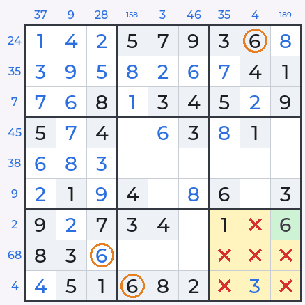

#### Step 30: the 8 in box 9

Box 9 needs an 8. r8c7, r8c8 and r8c9: row 8 has one (r8c1). r9c7 and r9c9: row 9 has one (r9c5). Only **r7c8** is left: **r7c8 = 8**.

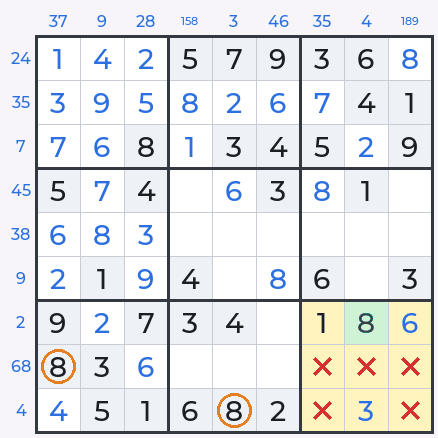

#### Step 31: the 9 in row 4

Row 4 needs a 9. r4c9: column 9 has one (r3c9). Only **r4c4** is left: **r4c4 = 9**.

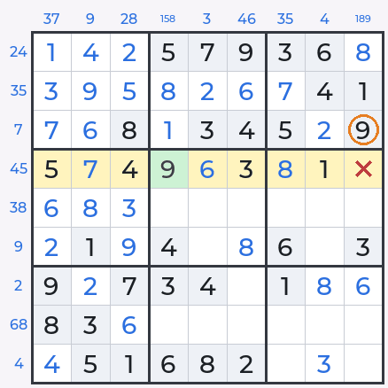

#### Step 32: the 2 in box 5

Box 5 needs a 2. r5c5: column 5 has one (r2c5). r5c6: column 6 has one (r9c6). r6c5: row 6 has one (r6c1). Only **r5c4** is left: **r5c4 = 2**.

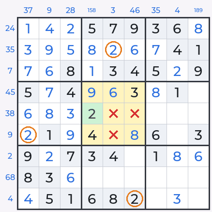

#### Step 33: the 7 in box 5

Box 5 needs a 7. r5c5 and r6c5: column 5 has one (r1c5). Only **r5c6** is left: **r5c6 = 7**.

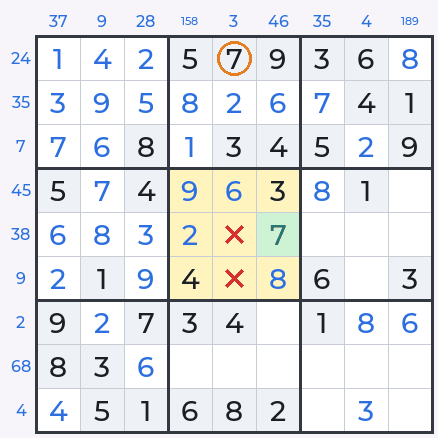

#### Step 34: the 1 in box 5

Box 5 needs a 1. r6c5: row 6 has one (r6c2). Only **r5c5** is left: **r5c5 = 1**.

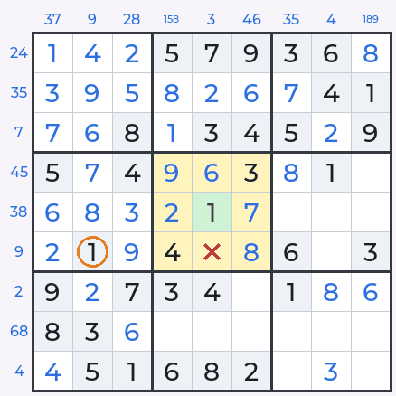

#### Step 35: the 5 in box 5

Box 5 needs a 5, and r6c5 is its last empty cell: **r6c5 = 5**.

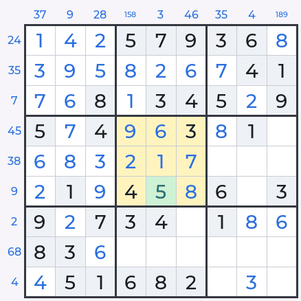

#### Step 36: the 2 in box 6

Box 6 needs a 2. r5c7, r5c8 and r5c9: row 5 has one (r5c4). r6c8: row 6 has one (r6c1). Only **r4c9** is left: **r4c9 = 2**.

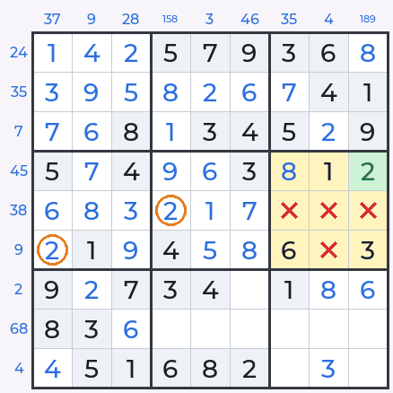

#### Step 37: the 7 in box 6

Box 6 needs a 7. r5c7, r5c8 and r5c9: row 5 has one (r5c6). Only **r6c8** is left: **r6c8 = 7**.

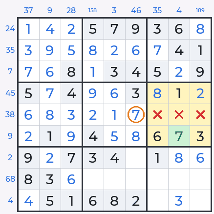

#### Step 38: the 1 in box 8

Box 8 needs a 1. r7c6: row 7 has one (r7c7). r8c4: column 4 has one (r3c4). r8c5: column 5 has one (r5c5). Only **r8c6** is left: **r8c6 = 1**.

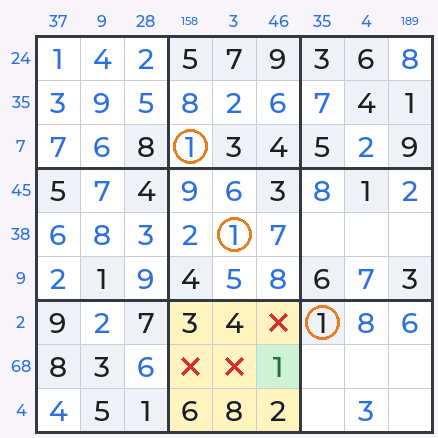

#### Step 39: the 5 in box 8

Box 8 needs a 5. r8c4: column 4 has one (r1c4). r8c5: column 5 has one (r6c5). Only **r7c6** is left: **r7c6 = 5**.

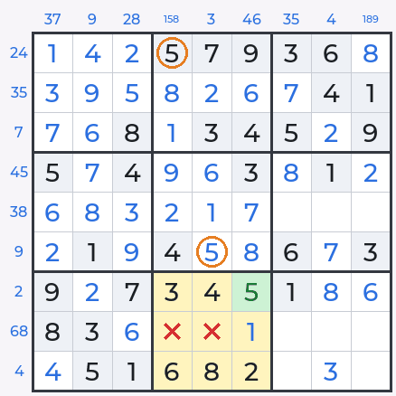

#### Step 40: the 7 in box 8

Box 8 needs a 7. r8c5: column 5 has one (r1c5). Only **r8c4** is left: **r8c4 = 7**.

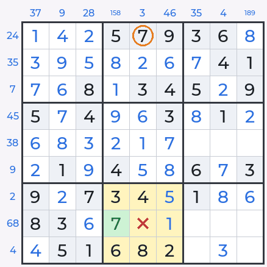

#### Step 41: the 9 in box 8

Box 8 needs a 9, and r8c5 is its last empty cell: **r8c5 = 9**.

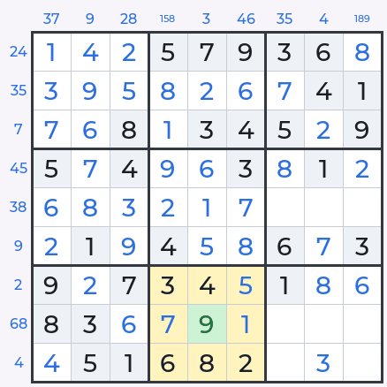

#### Step 42: the 2 in box 9

Box 9 needs a 2. r8c8: column 8 has one (r3c8). r8c9: column 9 has one (r4c9). r9c7 and r9c9: row 9 has one (r9c6). Only **r8c7** is left: **r8c7 = 2**.

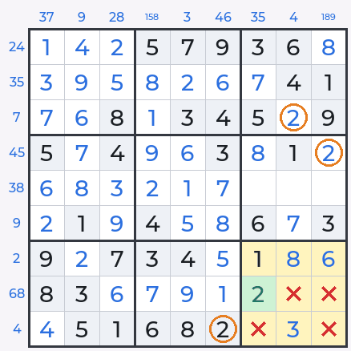

#### Step 43: the 4 in box 9

Box 9 needs a 4. r8c8: column 8 has one (r2c8). r9c7 and r9c9: row 9 has one (r9c1). Only **r8c9** is left: **r8c9 = 4**.

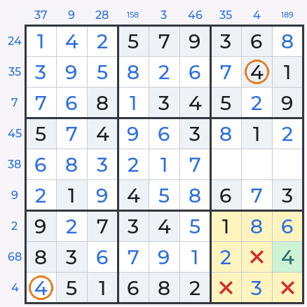

#### Step 44: the 4 in box 6

Box 6 needs a 4. r5c8: column 8 has one (r2c8). r5c9: column 9 has one (r8c9). Only **r5c7** is left: **r5c7 = 4**.

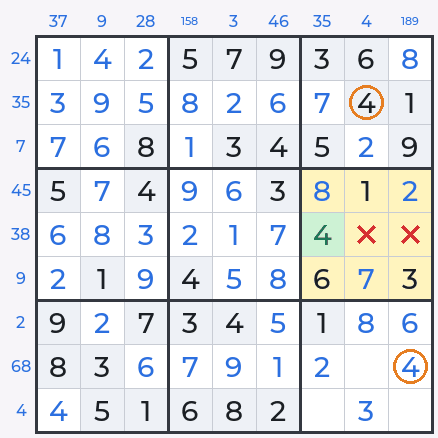

#### Step 45: the 9 in box 6

Box 6 needs a 9. r5c9: column 9 has one (r3c9). Only **r5c8** is left: **r5c8 = 9**.

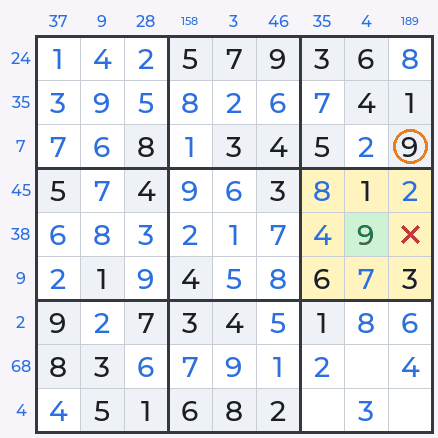

#### Step 46: the 5 in box 6

Box 6 needs a 5, and r5c9 is its last empty cell: **r5c9 = 5**.

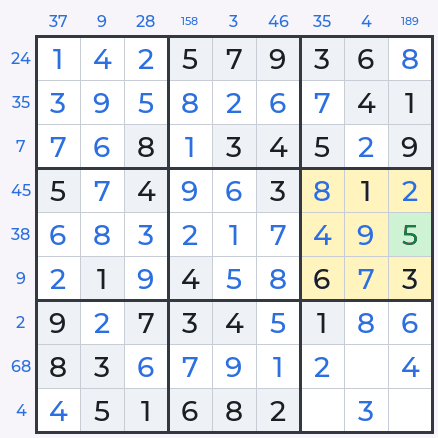

#### Step 47: the 5 in box 9

Box 9 needs a 5. r9c7 and r9c9: row 9 has one (r9c2). Only **r8c8** is left: **r8c8 = 5**.

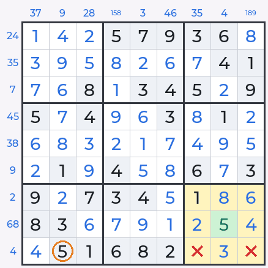

#### Step 48: the 7 in box 9

Box 9 needs a 7. r9c7: column 7 has one (r2c7). Only **r9c9** is left: **r9c9 = 7**.

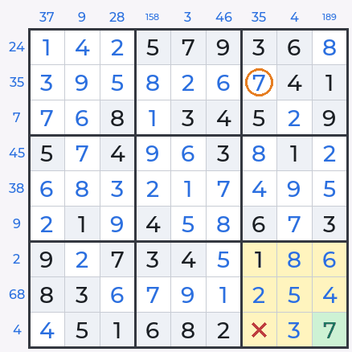

#### Step 49: the 9 in box 9

Box 9 needs a 9, and r9c7 is its last empty cell: **r9c7 = 9**.

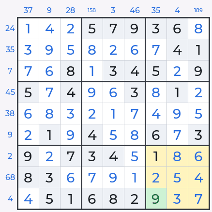

Solved.

<!-- /walkthrough -->
